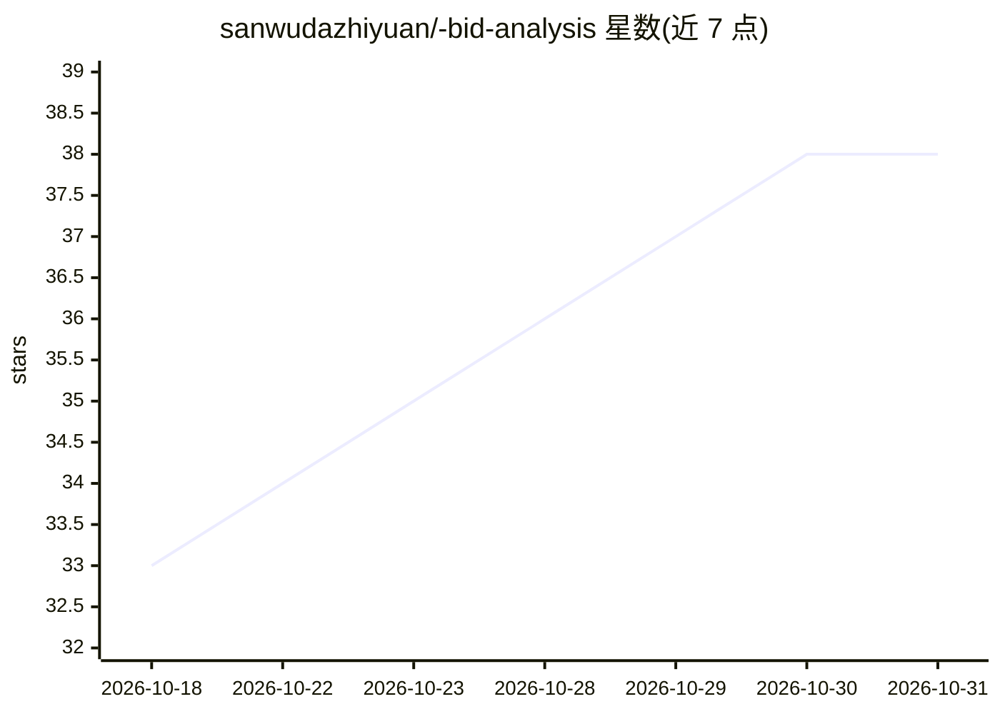

# sanwudazhiyuan/-bid-analysis

⭐ 38 · TypeScript · Apache-2.0 · 推送 2026-04-23 · [GitHub](https://github.com/sanwudazhiyuan/-bid-analysis) · 个人维护 · 中文 README

**招标文件 AI 解析与投标文件审查系统：解读、合规审查、暗标审核**

面向政企投标场景的 Web 系统。上传 .doc/.docx/.pdf 招标文件后，经解析、智能索引（TOC/编号/关键词三层）、9 模块结构提取（LLM JSON 输出）生成分析报告、投标格式模板、大纲与资料清单。审查含固定审核（LLM 直接判定）与智能审核（Agent 自主浏览章节 MD 文件，Read/Glob/Grep 工具）两种模式，另提供暗标审核（格式+内容双规则引擎，含可识别性测试等 5 层误报抑制）。技术栈 Vue 3 + FastAPI + PostgreSQL + Celery，Docker Compose 7 容器部署。模型支持通义千问云端与 Ollama 本地模式切换，管理员可配置。

## 筛选速览

| 维度 | 判定 | 备注 |
|---|---|---|
| AI 角色 | `ai-native` | 本体是模型或模型工具 |
| 许可风险 | `permissive` | Apache-2.0 |
| 部署形态 | `self-host` | docker 或自建部署 |
| 模型依赖 | local-ok | 支持本地模型 |
| 硬件要求 | — | 无带数字的原话,不猜 |
| 安装摩擦 | `low` | 无编译、无系统依赖或容器化 |
| 成熟度 | — | 结构信号不足 |

## 能力要点

- 9 模块并行提取：关键词得分制筛选 + 语义向量补漏 + 分批防上下文超限
- 智能审核由 Agent 自主浏览章节化 Markdown 文件夹后判定
- 暗标审核格式/内容双规则引擎，含可识别性测试等 5 层误报抑制机制
- 审查结果以 Word 原生批注锚定到具体段落，可追溯原文

## 适用场景

- 投标团队快速解读上百页招标文件并生成结构化报告
- 投标前自动核查标书是否满足招标实质性条款
- 匿名评审场景检测投标文件是否泄露投标人身份信息
- 内网环境用 Ollama 本地模型完成解析与审查

## 场景标签

`文档解析` `文档问答` · 领域:知识与检索

## 证据(README 行号)

> L3: 一套面向政企办公场景的招标文件深度解析与标书审查工具。上传招标文件（.doc / .docx / .pdf），AI 自动提取关键信息并生成结构化分析报告、投标文件格式模板、投标文件大纲和资料清单。同时支持两类独立的审查能力：
> L12: - **提效** — 传统人工阅读一份 100+ 页招标文件需 2-4 小时，AI 解析只需 5-10 分钟
> L346: |AI 模型|通义千问 / Ollama 本地模型|支持云端和本地部署切换|

## 星数曲线

2026-10-18 33 → 2026-10-31 38（+5）

---
*卡片 v1 · prompt 1.4 · 生成 2026-10-25 · 置信度 high · 依据 README sha `b25cc362894d` · [字段定义](../../DATASET.md)*
