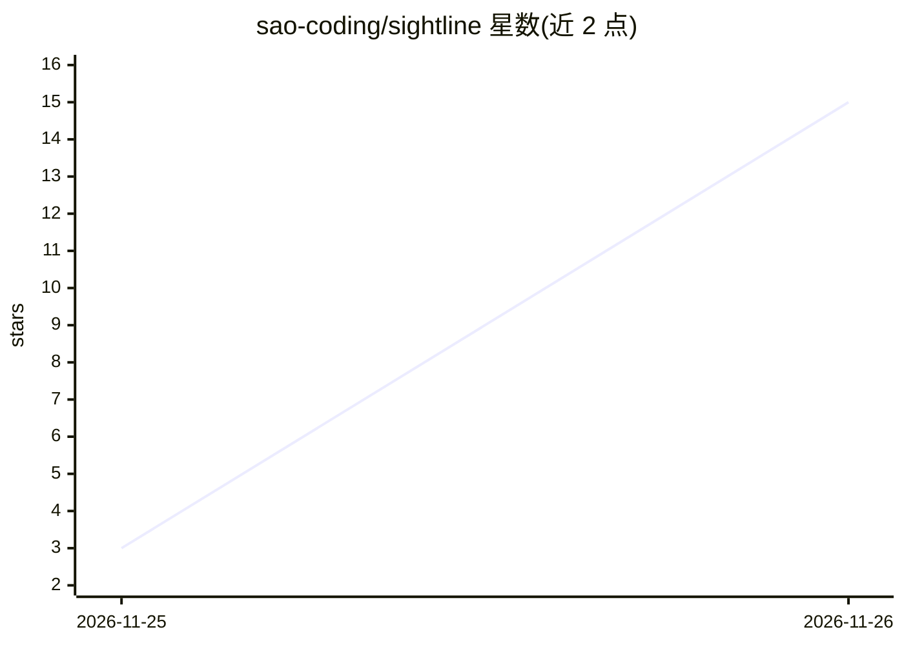

# sao-coding/sightline

⭐ 15 · Rust · AGPL-3.0 · 推送 2026-11-24 · [GitHub](https://github.com/sao-coding/sightline) · 个人维护 · 中文 README

**给 Windows 上 AI 编码代理提供窗口截图与进程监控的 CLI 工具**

面向运行在 Windows 上的 AI 编码代理的单文件命令行工具，命令为 sight：查找窗口、截取被遮挡窗口的图像、等待 UI 稳定后输出图像像素到屏幕像素的映射公式，并测量整个进程树的 CPU 与内存。只观察不操作，通过返回文件路径而非 base64 以节省 token，输出单行 JSON 与稳定错误码。支持 PowerShell 一键安装、手动下载与 Rust 源码构建，通过 AGENTS.md 与 Agent Skill 集成到代理工作流。

## 筛选速览

| 维度 | 判定 | 备注 |
|---|---|---|
| AI 角色 | `ai-ecosystem` | LLM/agent 周边工具 |
| 许可风险 | `viral` | AGPL-3.0 |
| 部署形态 | `desktop` | 安装包/桌面程序 |
| 模型依赖 | — | README 未给出锁定关系 |
| 硬件要求 | — | 无带数字的原话,不猜 |
| 安装摩擦 | `medium` | 含编译或系统依赖之一 |
| 成熟度 | — | 结构信号不足 |

## 能力要点

- 截取被遮挡窗口与自身弹窗，返回图像像素到屏幕像素的坐标公式
- --settle 等待 UI 像素稳定并输出 settled 状态
- stat 命令测量整个进程树的 CPU（avg/p95/max）与私有字节内存
- 截图只返回文件路径，无网络代码，数据不离开本机

## 适用场景

- 让编码代理检查 Windows 应用界面渲染结果
- 代理操作 UI 后用坐标公式在屏幕位置进行下一步操作
- 监控 Electron 应用或浏览器等进程树的资源占用
- 处理高 DPI 缩放环境下的屏幕坐标换算

## 场景标签

 · 领域:开发者工具/AI 代理辅助

## 证据(README 行号)

> L10: Eyes and a stopwatch for AI coding agents on Windows. One small exe, command `sight`.
> L14: whole process tree. It **only observes**: it never clicks, types or moves the mouse. The agent

## 星数曲线

2026-11-25 3 → 2026-11-26 15（+12）

---
*卡片 v1 · prompt 1.4 · 生成 2026-11-24 · 置信度 high · 依据 README sha `d6548b9cf362` · [字段定义](../../DATASET.md)*
