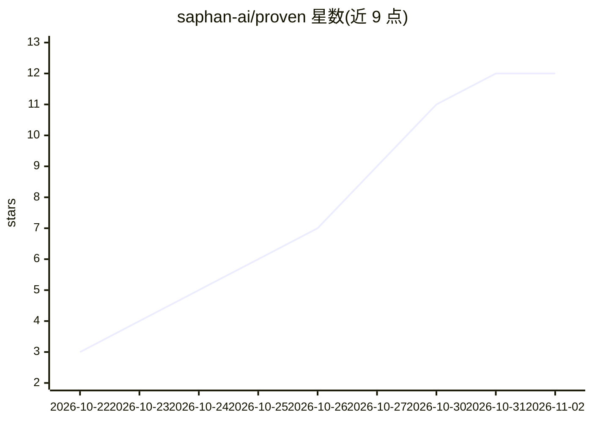

# saphan-ai/proven

⭐ 12 · Go · Apache-2.0 · 推送 2026-10-29 · [GitHub](https://github.com/saphan-ai/proven) · [官网](https://saphan.ai) · 个人维护

**必须出示证据的 AI 代码评审工具：附失败测试或数据查询**

面向拉取请求评审的 AI 工具：六个 Agent（Planner/Investigator/Prover/Skeptic/Judge/Writer）协作，只报告可证明的问题——在改动上失败、在此前代码上通过的测试，或带返回行的数据查询（OSV/CISA KEV/FIRST EPSS 漏洞库）。测试在无网络无密钥的容器中运行，每次评审留下签名证据包，`proven verify` 可离线重推每个结论。评审模型默认 Qwen 与 DeepSeek，NVIDIA 安全模型做护栏；可部署为 GitHub/Gitea Action 或完全离线运行。README 详细列出未测量项与已知限制。为 2026 年 Open Agent Hackathon 六天内由 AI 编码舰队公开构建的项目。

## 筛选速览

| 维度 | 判定 | 备注 |
|---|---|---|
| AI 角色 | `ai-native` | 本体是模型或模型工具 |
| 许可风险 | `permissive` | Apache-2.0 |
| 部署形态 | `self-host` | docker 或自建部署 |
| 模型依赖 | locked-api |  |
| 硬件要求 | — | 无带数字的原话,不猜 |
| 安装摩擦 | `low` | 无编译、无系统依赖或容器化 |
| 成熟度 | — | 结构信号不足 |

## 能力要点

- 六 Agent 流水线，'无证据不报告'：Judge 按固定规则计数证据，模型置信度不算数
- Prover 在无网络无密钥容器中运行测试，命令由 Proven 自建而非模型生成
- 签名证据包 + `proven verify` 离线重推每个裁决
- 输出 PR 评论、JSON、SARIF 与文本；支持 GitHub/Gitea/自托管/完全离线

## 适用场景

- 在拉取请求上获得附带可复现证据的 AI 评审
- 安全变更由第二模型族（不同家族）独立复审
- 离线验证历史评审结论是否成立

## 场景标签

`代码审查` `网络安全` · 领域:编码与开发

## 证据(README 行号)

> L37: Proven reviews a pull request with six agents: a **Planner** names the risks, an **Investigator** gathers facts, a
> L41: - **No evidence, no finding.** A finding counts only with a test that fails on the change and passes on the code be

## 星数曲线

2026-10-22 3 → 2026-11-02 12（+9）

---
*卡片 v1 · prompt 1.4 · 生成 2026-11-01 · 置信度 mid · 依据 README sha `178c2f863aa4` · [字段定义](../../DATASET.md)*
