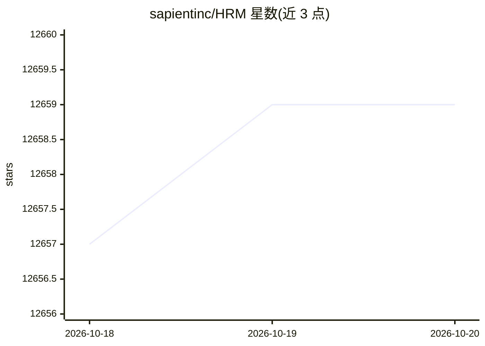

# sapientinc/HRM

⭐ 12,659 · Python · Apache-2.0 · 推送 2026-03-31 · [GitHub](https://github.com/sapientinc/HRM) · [官网](https://sapient.inc) · 组织维护

**27M 参数的两层级联循环推理模型官方实现**

Sapient 公司发布的 Hierarchical Reasoning Model（HRM）官方代码库：受人脑多时间尺度层级处理启发的循环架构，包含负责慢速抽象规划的高层模块与负责快速细节计算的低层模块，在单次前向传播中执行序列推理，无需预训练或 CoT 数据。论文称以 27M 参数、1000 训练样本在复杂数独、迷宫寻路及 ARC 基准上取得高准确率。仓库提供训练与评估脚本、已训练检查点（ARC-AGI-2、Sudoku、Maze），依赖 PyTorch、CUDA、FlashAttention，实验跟踪使用 W&B；单卡 RTX 4070 可跑数独 demo（约 10 小时），完整实验假定 8 GPU 环境。

## 筛选速览

| 维度 | 判定 | 备注 |
|---|---|---|
| AI 角色 | `ai-native` | 本体是模型或模型工具 |
| 许可风险 | `permissive` | Apache-2.0 |
| 部署形态 | `library` | 以包/库形式分发 |
| 模型依赖 | — | README 未给出锁定关系 |
| 硬件要求 | — | 无带数字的原话,不猜 |
| 安装摩擦 | `medium` | 含编译或系统依赖之一 |
| 成熟度 | — | 结构信号不足 |

## 能力要点

- 高层慢规划 + 低层快计算的双循环模块架构，单次前向传播完成推理
- 提供 ARC-AGI-2、Sudoku 9x9 Extreme、Maze 30x30 Hard 训练检查点
- 小样本训练：1000 样本、27M 参数，无需预训练或 CoT 数据
- W&B 集成的实验跟踪与评估脚本、数据集可视化工具

## 适用场景

- 我在单张笔记本 GPU 上训练求解极难数独的模型
- 我在 8 卡环境复现 ARC-AGI-2 小样本学习实验
- 我研究受脑启发的层级推理架构并与 CoT 方法对比

## 场景标签

`模型训练` `科研工具` · 领域:学习与行业

## 证据(README 行号)

> L4: Current large language models (LLMs) primarily employ Chain-of-Thought (CoT) techniques, which suffer from brittle t
> L5: HRM executes sequential reasoning tasks in a single forward pass without explicit supervision of the intermediate pr

## 星数曲线

2026-10-18 12,657 → 2026-10-20 12,659（+2）

---
*卡片 v1 · prompt 1.4 · 生成 2026-10-20 · 置信度 high · 依据 README sha `21b1891784d5` · [字段定义](../../DATASET.md)*
