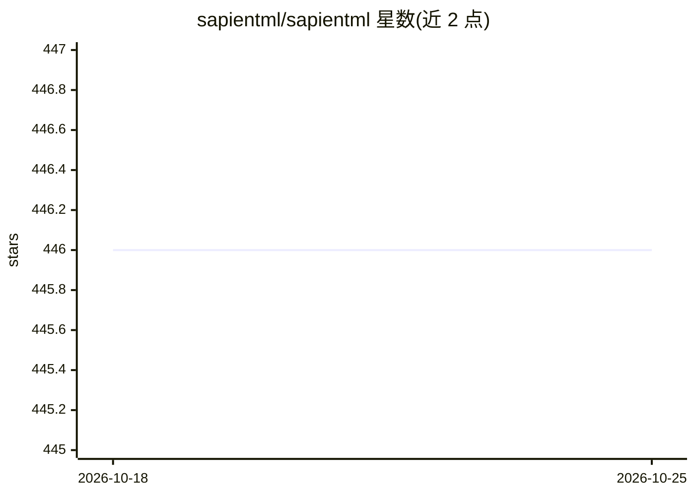

# sapientml/sapientml

⭐ 446 · Python · Apache-2.0 · 推送 2026-10-05 · [GitHub](https://github.com/sapientml/sapientml) · [官网](https://sapientml.io/) · 组织维护

**表格数据生成式 AutoML：自动产出预测任务的 ML 流水线**

SapientML 是面向表格数据的 AutoML 库：从已有数据集与人工编写流水线的语料中学习，为新数据集的预测任务（分类/回归）生成完整 ML 流水线。提供 fit/predict/save 接口，可通过 codegen_only 模式仅获取生成代码再用其他数据训练。以 Python 库（pip）分发，需 Python 3.10–3.13，支持源码（poetry）安装；技术在 ICSE 2022 论文中发表，并在 HuggingFace Spaces 提供在线演示。

## 筛选速览

| 维度 | 判定 | 备注 |
|---|---|---|
| AI 角色 | `ai-native` | 本体是模型或模型工具 |
| 许可风险 | `permissive` | Apache-2.0 |
| 部署形态 | `library` | 以包/库形式分发 |
| 模型依赖 | — | README 未给出锁定关系 |
| 硬件要求 | — | 无带数字的原话,不猜 |
| 安装摩擦 | `low` | 无编译、无系统依赖或容器化 |
| 成熟度 | — | 结构信号不足 |

## 能力要点

- 从数据集与人工流水线语料学习并生成新任务的 ML 流水线
- 支持分类与回归任务，附 Titanic、房价等 Colab 示例
- codegen_only 模式可仅生成代码并用其他数据重训
- HuggingFace Spaces 在线演示

## 适用场景

- 给我的表格数据集自动生成分类或回归流水线
- 获取可导出的生成代码自行训练与部署
- 在 Colab 中快速跑 AutoML 示例

## 场景标签

`MLOps` `代码生成` · 领域:编码与开发

## 证据(README 行号)

> L5: SapientML is an AutoML technology that can learn from a corpus of existing datasets and their human-written pipeline
> L53: You can access `model` field to get a model consisting of generated code after executing `fit` method.

## 星数曲线

2026-10-18 446 → 2026-10-25 446（+0）

---
*卡片 v1 · prompt 1.4 · 生成 2026-10-21 · 置信度 high · 依据 README sha `7c63fb3098a6` · [字段定义](../../DATASET.md)*
