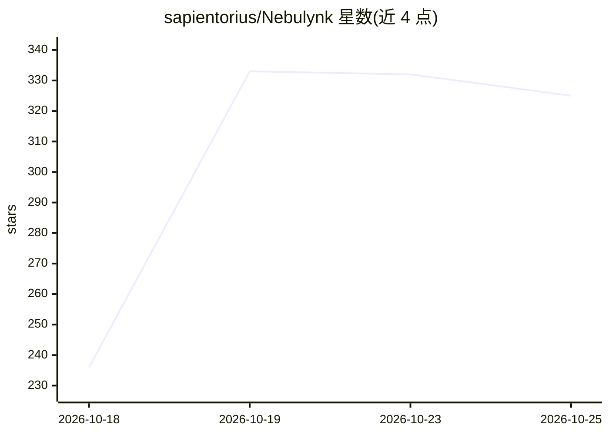

# sapientorius/Nebulynk

⭐ 325 · JavaScript · NOASSERTION · 推送 2026-10-25 · [GitHub](https://github.com/sapientorius/Nebulynk) · [官网](https://nebulynk.net) · 个人维护

**自托管团队协作平台：聊天、会议与可选 AI 辅助**

面向团队的自托管协作产品，整合频道聊天、语音视频会议、屏幕共享、文件、搜索、提醒与通知，以及基于 BYOK（自带 API key）的可选 AI 功能：转写、会议摘要、可检索的后续事项与过往会议的上下文问答。自带 Docker 部署资源，支持 Coolify/Dokploy/Plesk 等部署方式。采用 BSL 1.1 源码可用许可（非开源许可），免费生产使用受许可条件限制；技术栈为 FeathersJS、Vue.js、LiveKit、PostgreSQL、Redis。

## 筛选速览

| 维度 | 判定 | 备注 |
|---|---|---|
| AI 角色 | `ai-enhanced` | 去掉 AI 部分产品仍成立 |
| 许可风险 | `none` | NOASSERTION |
| 部署形态 | `None` |  |
| 模型依赖 | — | README 未给出锁定关系 |
| 硬件要求 | — | 无带数字的原话,不猜 |
| 安装摩擦 | `low` | 无编译、无系统依赖或容器化 |
| 成熟度 | — | 结构信号不足 |

## 能力要点

- 聊天、语音视频会议、屏幕共享、文件与搜索整合于同一工作区
- BYOK 模式的可选 AI 功能：转写、会议摘要、后续事项检索
- 角色权限、访客访问、passkey 与双因素认证
- 提供 Docker 部署资源与 GHCR 镜像

## 适用场景

- 团队在自有基础设施上运行聊天与会议平台
- 用自带 key 的 AI 生成会议摘要与可检索的后续事项
- 需要数据与 AI 供应商可控的团队协作环境

## 场景标签

`语音识别` · 领域:感知与多模态

## 证据(README 行号)

> L6: Nebulynk brings the everyday flow of teamwork into one place: focused chat,
> L24: Nebulynk uses a bring-your-own-key (BYOK) model for AI features. Choose the

## 星数曲线

2026-10-18 236 → 2026-10-25 325（+89）

---
*卡片 v1 · prompt 1.4 · 生成 2026-10-21 · 置信度 high · 依据 README sha `c641c0301ffc` · [字段定义](../../DATASET.md)*
