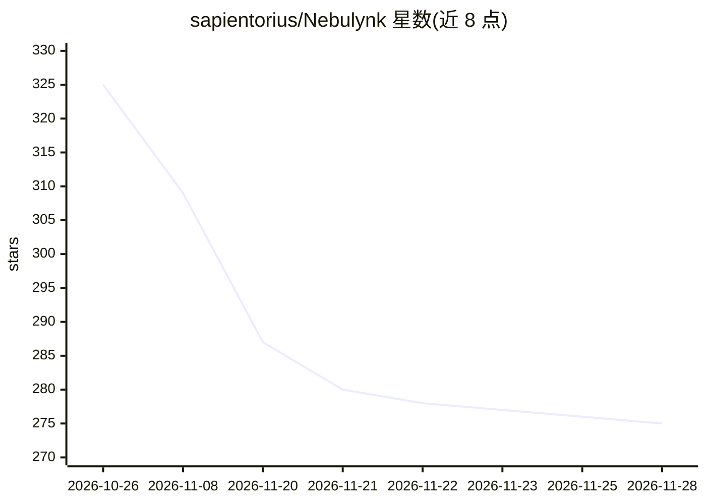

# sapientorius/Nebulynk

⭐ 275 · JavaScript · NOASSERTION · 推送 2026-11-25 · [GitHub](https://github.com/sapientorius/Nebulynk) · [官网](https://nebulynk.net) · 组织维护

**自托管团队协作平台：聊天、会议与 AI 跟进一体化**

Nebulynk 是一个自托管的团队协作平台，集成频道与私信聊天、语音视频会议、屏幕共享、文件与搜索，并提供可选的 AI 功能：会议转录、会议摘要、可搜索跟进内容与针对历史会议的上下文问答。AI 功能采用 BYOK 模式，用户自选模型提供方并自行管理密钥。项目以 BSL 1.1 源码可用许可发布，支持 Docker 部署与 Coolify/Dokploy/Plesk 等平台部署，浏览器/PWA 访问，另有可选的 Windows/macOS 全局按键说话辅助程序。

## 筛选速览

| 维度 | 判定 | 备注 |
|---|---|---|
| AI 角色 | `ai-enhanced` | 去掉 AI 部分产品仍成立 |
| 许可风险 | `none` | NOASSERTION |
| 部署形态 | `None` |  |
| 模型依赖 | — | README 未给出锁定关系 |
| 硬件要求 | — | 无带数字的原话,不猜 |
| 安装摩擦 | `low` | 无编译、无系统依赖或容器化 |
| 成熟度 | — | 结构信号不足 |

## 能力要点

- BYOK 模式：自选 AI 提供方与模型，密钥由用户控制
- 语音/视频会议、屏幕共享与定时会议
- AI 转录、会议摘要与历史会议上下文问答
- 提供 GHCR 镜像与 Coolify/Dokploy/Plesk 部署文档

## 适用场景

- 团队在一个自托管工作区内完成聊天与视频会议
- 会议结束后自动生成转录与摘要跟进事项
- 在自有基础设施上运行协作工具以掌控数据

## 场景标签

`语音识别` `文档问答` · 领域:知识与检索

## 证据(README 行号)

> L24: Nebulynk uses a bring-your-own-key (BYOK) model for AI features. Choose the
> L27: summaries, searchable follow-up, and contextual answers about past meetings.
> L7: voice and video meetings, files, search, notifications, and optional AI tools

## 星数曲线

2026-10-26 325 → 2026-11-28 275（-50）

---
*卡片 v1 · prompt 1.4 · 生成 2026-11-25 · 置信度 high · 依据 README sha `62103940cb18` · [字段定义](../../DATASET.md)*
