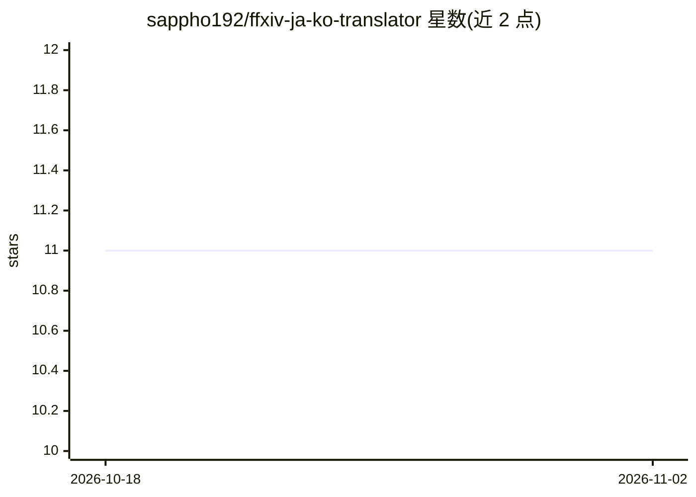

# sappho192/ffxiv-ja-ko-translator

⭐ 11 · C# · MIT · 推送 2026-07-02 · [GitHub](https://github.com/sappho192/ffxiv-ja-ko-translator) · [官网](https://sappho192.github.io/ffxiv-ja-ko-translator/) · 个人维护

**面向《最终幻想14》的日韩翻译模型（BERT-Japanese+KoGPT2）**

为解决通用翻译服务（Papago/DeepL）在特定游戏文本上不够准确的问题而训练的日→韩翻译模型：编码器为 BERT-Japanese，解码器为 KoGPT2，使用 tatoeba_mt 的 jpn-kor 子数据集与游戏内自动翻译语句训练，提供 PyTorch 与 Optimum.ONNXRuntime 两种推理代码，以及 HuggingFace Space 网页演示和 Windows ONNX GUI 应用示例。限制：句长不得超过 512 字符，仅考虑日韩语言对，处于 Proof of Concept 阶段，数据集遵循 Square Enix 材料使用许可不直接公开。

## 筛选速览

| 维度 | 判定 | 备注 |
|---|---|---|
| AI 角色 | `ai-native` | 本体是模型或模型工具 |
| 许可风险 | `permissive` | MIT |
| 部署形态 | `self-host` | docker 或自建部署 |
| 模型依赖 | — | README 未给出锁定关系 |
| 硬件要求 | — | 无带数字的原话,不猜 |
| 安装摩擦 | `low` | 无编译、无系统依赖或容器化 |
| 成熟度 | `idea` | |

## 能力要点

- EncoderDecoder 架构（BERT-Japanese 编码 + KoGPT2 解码）的日→韩翻译模型
- 提供 PyTorch 与 Optimum.ONNXRuntime（含量化 ONNX）两种推理路径
- 使用 FFXIV 游戏内自动翻译语句作为主要领域训练数据
- 附 Docker 环境、训练 notebook 与 Windows ONNX GUI 应用示例

## 适用场景

- 我在 FFXIV 日服游戏中与日本玩家沟通时翻译聊天文本
- 替换通用翻译服务以获得更准确的游戏术语翻译
- 参考该结构训练其他语言对的领域专用翻译模型

## 场景标签

 · 领域:NLP/机器翻译（游戏领域）

## 证据(README 行号)

> L3: Japanese→Korean Translator specialized in Final Fantasy XIV
> L14: Papago and DeepL can be a great choice in common situation, but not for the text in specific game. So I'm trying to

## 星数曲线

2026-10-18 11 → 2026-11-02 11（+0）

---
*卡片 v1 · prompt 1.4 · 生成 2026-11-01 · 置信度 mid · 依据 README sha `41fd18267215` · [字段定义](../../DATASET.md)*
