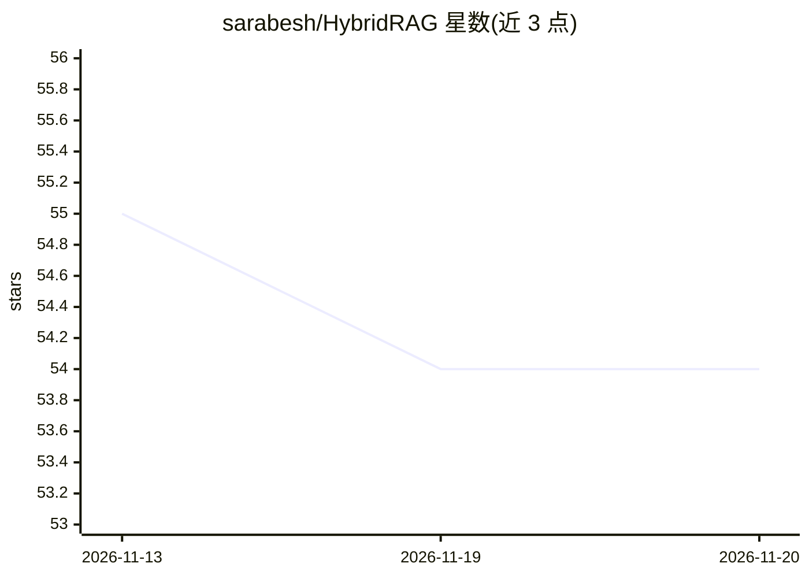

# sarabesh/HybridRAG

⭐ 54 · Jupyter Notebook · 推送 2026-11-13 · [GitHub](https://github.com/sarabesh/HybridRAG) · 个人维护

**对比向量检索与图检索效果的 RAG 实验 notebook**

单 notebook 实验：将同一语料（F1 锦标赛 Wikipedia PDF）与同一组问题跑过三种检索配置——纯向量、向量+关键词、向量+知识图——并排比较 LLM 回答。技术栈为 LangChain 编排、本地 Neo4j 向量库、Neo4j Aura 知识图（5,364 节点/37,055 关系）、Ollama 运行 llama3.2 做嵌入与生成、Gemini 做实体抽取。README 明确声明：这是定性对比而非量化基准，知识图构建依赖托管工具 llm-graph-builder，属手工步骤，无法仅从本仓库复现；且需两个 Neo4j 实例。

## 筛选速览

| 维度 | 判定 | 备注 |
|---|---|---|
| AI 角色 | `ai-knowledge` | 知识聚合/清单类 |
| 许可风险 | `none` | — |
| 部署形态 | `None` |  |
| 模型依赖 | local-ok | 支持本地模型 |
| 硬件要求 | — | 无带数字的原话,不猜 |
| 安装摩擦 | `low` | 无编译、无系统依赖或容器化 |
| 成熟度 | — | 结构信号不足 |

## 能力要点

- 同一语料与问题下三种检索配置的并排回答对比
- 结构化检索器：Gemini 实体抽取 + 模糊全文匹配 + Cypher 邻域遍历
- 知识图规模 5,364 节点与 37,055 关系
- README 自陈无量化评估、图构建不可复现等已知缺口

## 适用场景

- 了解知识图对关系型/次序型问题的检索增益
- 参考向量+图混合检索的实现方式与组件选型
- 作为 Graph RAG 教学或实验起点

## 场景标签

`RAG` `知识图谱` · 领域:知识与检索

## 证据(README 行号)

> L5: This notebook answers that by running the same corpus and the same questions through three retrieval configurations 
> L82: It is a worked comparison. Each stage is built up in the notebook with the reasoning written out, and the same ques
> L84: It is not an evaluated benchmark. The comparison is qualitative. There is no recall or answer accuracy measured ove

## 星数曲线

2026-11-13 55 → 2026-11-20 54（-1）

---
*卡片 v1 · prompt 1.4 · 生成 2026-11-18 · 置信度 high · 依据 README sha `bf2d87862cf5` · [字段定义](../../DATASET.md)*
