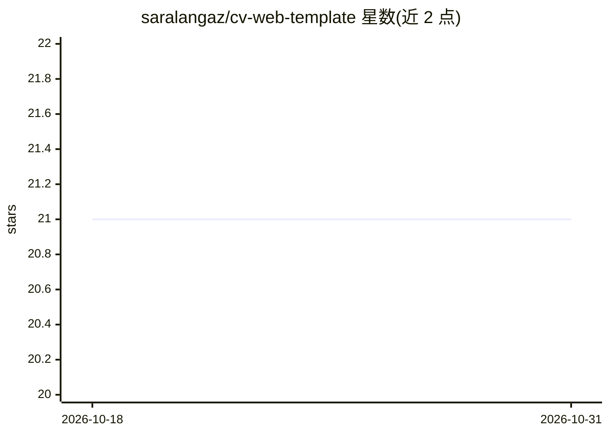

# saralangaz/cv-web-template

⭐ 21 · HTML · 推送 2026-07-31 · [GitHub](https://github.com/saralangaz/cv-web-template) · [官网](https://saralangaz.com) · 个人维护

**带 AI 聊天助手的个人简历网站模板，免费部署**

单文件 HTML/CSS/JS 的个人 CV 网站模板，包含技能、经历、项目、证书等板块，内置 ES/EN 双语切换。访客可通过 AI 聊天组件询问站长信息，由 Cloudflare Worker 代理调用 Workers AI 上的 Llama 3.3 70B，配合 KV 做速率限制；托管在 GitHub Pages 或 Cloudflare Pages。个人数据存放在 gitignored 的 config 文件中，整个技术栈使用免费额度，可选支出仅自定义域名。

## 筛选速览

| 维度 | 判定 | 备注 |
|---|---|---|
| AI 角色 | `ai-enhanced` | 去掉 AI 部分产品仍成立 |
| 许可风险 | `none` | — |
| 部署形态 | `library` | 以包/库形式分发 |
| 模型依赖 | — | README 未给出锁定关系 |
| 硬件要求 | — | 无带数字的原话,不猜 |
| 安装摩擦 | `low` | 无编译、无系统依赖或容器化 |
| 成熟度 | — | 结构信号不足 |

## 能力要点

- 单文件实现，无构建步骤、无依赖
- AI 聊天组件经 Cloudflare Worker 代理调用 Llama 3.3 70B
- Cloudflare KV 速率限制（10万/天）
- ES/EN 双语切换，个人数据存 gitignored 配置文件

## 适用场景

- 30 分钟内部署免费的个人简历网站
- 让访客通过 AI 对话了解我的背景与经历
- 双语展示个人技能、经历与项目

## 场景标签

`聊天机器人` · 领域:对话与助手

## 证据(README 行号)

> L14: - **AI chat widget** — visitors can ask questions about your profile, powered by Llama 3.3 (free)
> L22: |AI chat model|Llama 3.3 70B via Cloudflare Workers AI|Free (10k req/day)|

## 星数曲线

2026-10-18 21 → 2026-10-31 21（+0）

---
*卡片 v1 · prompt 1.4 · 生成 2026-10-28 · 置信度 high · 依据 README sha `e3f8ffb44188` · [字段定义](../../DATASET.md)*
