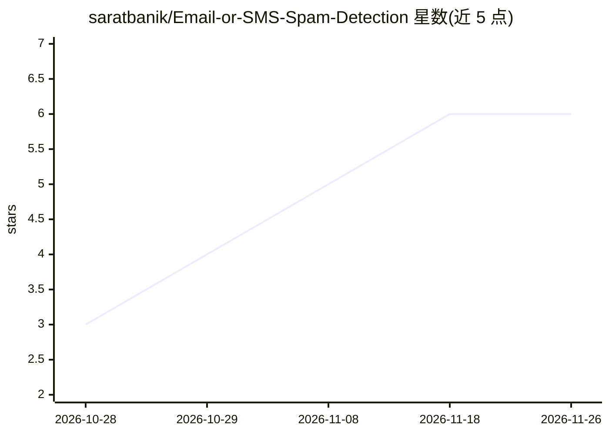

# saratbanik/Email-or-SMS-Spam-Detection

⭐ 6 · Jupyter Notebook · 推送 2026-10-27 · [GitHub](https://github.com/saratbanik/Email-or-SMS-Spam-Detection) · 个人维护

**检测邮件与短信垃圾消息的 NLP Web 应用**

基于 Streamlit 的垃圾消息分类 Web 应用：用户输入邮件或短信文本，经 NLTK 文本清洗与规范化后，由 TF-IDF 向量器提取特征，加载预训练的 Multinomial Naive Bayes 分类器实时预测 Spam/Ham 类别，无需每次重新训练模型。附带 Jupyter Notebook 展示模型开发与分析流程。面向学习与演示机器学习文本分类流程的用户，README 未说明提供部署版本，部署列为未来改进项。

## 筛选速览

| 维度 | 判定 | 备注 |
|---|---|---|
| AI 角色 | `ai-native` | 本体是模型或模型工具 |
| 许可风险 | `none` | — |
| 部署形态 | `None` |  |
| 模型依赖 | — | README 未给出锁定关系 |
| 硬件要求 | — | 无带数字的原话,不猜 |
| 安装摩擦 | `low` | 无编译、无系统依赖或容器化 |
| 成熟度 | — | 结构信号不足 |

## 能力要点

- Multinomial Naive Bayes + TF-IDF 的垃圾消息二分类
- 预训练模型与向量化器已保存，加载即用无需重训
- Streamlit 交互界面实时输入并显示预测类别
- 提供 Jupyter Notebook 展示建模流程

## 适用场景

- 输入可疑短信或邮件判断是否为垃圾消息
- 学习文本预处理、TF-IDF 特征提取与朴素贝叶斯分类流程
- 参考 Streamlit 与 scikit-learn 集成开发 Web 应用

## 场景标签

 · 领域:机器学习/文本分类

## 证据(README 行号)

> L3: A machine learning web application that detects spam messages in emails and SMS using Natural Language Processing (N
> L55: 4. **Prediction:** The trained Multinomial Naive Bayes model classifies the message.

## 星数曲线

2026-10-28 3 → 2026-11-26 6（+3）

---
*卡片 v1 · prompt 1.4 · 生成 2026-11-20 · 置信度 high · 依据 README sha `5a71a5114050` · [字段定义](../../DATASET.md)*
