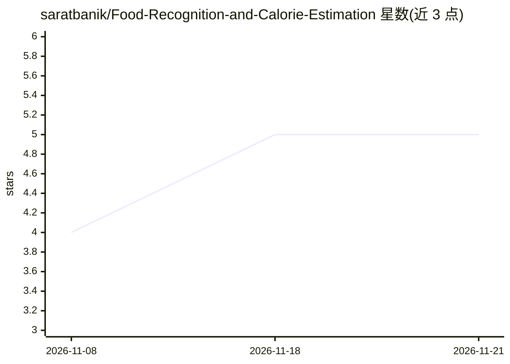

# saratbanik/Food-Recognition-and-Calorie-Estimation

⭐ 5 · Python · 推送 2026-11-01 · [GitHub](https://github.com/saratbanik/Food-Recognition-and-Calorie-Estimation) · 个人维护

**面向消费者的食物图像识别与卡路里估算 Web 应用**

基于 TensorFlow/Keras 与 MobileNetV2 迁移学习，在 Food-101 数据集（101 类、101,000 张图）上训练食物图像分类模型，输出预测类别、置信度与前五候选；随后从本地营养参考表查取每 100 克热量值，按用户输入的份量克数计算估算卡路里。提供 Streamlit 交互界面与命令行预测脚本，并生成训练曲线与混淆矩阵。README 明确说明卡路里为近似教学估算，不构成医疗或饮食建议。

## 筛选速览

| 维度 | 判定 | 备注 |
|---|---|---|
| AI 角色 | `ai-native` | 本体是模型或模型工具 |
| 许可风险 | `none` | — |
| 部署形态 | `library` | 以包/库形式分发 |
| 模型依赖 | — | README 未给出锁定关系 |
| 硬件要求 | — | 无带数字的原话,不猜 |
| 安装摩擦 | `low` | 无编译、无系统依赖或容器化 |
| 成熟度 | — | 结构信号不足 |

## 能力要点

- MobileNetV2 迁移学习，101 类食物分类，输出置信度与前五候选
- 本地营养参考表 + 用户输入份量克数计算估算卡路里
- Streamlit 交互 Web 应用与命令行预测脚本
- 生成训练历史与混淆矩阵等评估产物

## 适用场景

- 上传食物照片识别类别并按份量估算卡路里
- 营养教育类应用的参考实现
- Food-101 数据集上的迁移学习训练练习

## 场景标签

`目标检测` `AI 助手` · 领域:对话与助手

## 证据(README 行号)

> L3: A deep learning project that identifies food items from images and estimates their calorie content using a CNN-based
> L9: This project uses transfer learning with MobileNetV2 to classify food images into 101 categories from the Food-101 d
> L233: **Important limitation:** The application does not measure food weight, volume, ingredients, or portion size from 

## 星数曲线

2026-11-08 4 → 2026-11-21 5（+1）

---
*卡片 v1 · prompt 1.4 · 生成 2026-11-21 · 置信度 high · 依据 README sha `5d8cdd120b1d` · [字段定义](../../DATASET.md)*
