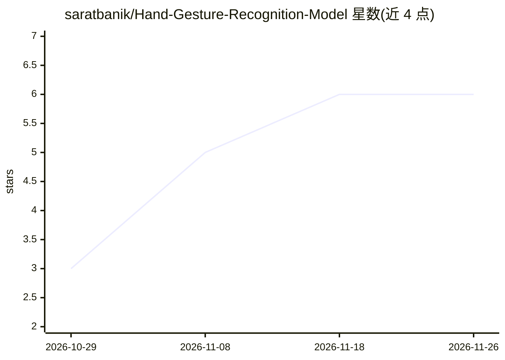

# saratbanik/Hand-Gesture-Recognition-Model

⭐ 6 · Python · 推送 2026-10-28 · [GitHub](https://github.com/saratbanik/Hand-Gesture-Recognition-Model) · 个人维护

**CNN 手势图像识别项目：训练、评估并预测 10 类手势**

基于 LEAPGestRecog 数据集训练 TensorFlow/Keras CNN 的手势识别项目，识别 10 类手势。提供 Streamlit Web 界面上传图像查看预测与分数、命令行图像预测脚本、训练脚本（生成混淆矩阵、评估指标与 .keras 模型文件），以及实验性的 OpenCV 摄像头演示。README 注明摄像头演示受限：数据集与普通 RGB 图像的传感环境不同，预测可能不准确。数据集需从 Kaggle 下载后放入 data/ 目录方可训练。

## 筛选速览

| 维度 | 判定 | 备注 |
|---|---|---|
| AI 角色 | `ai-native` | 本体是模型或模型工具 |
| 许可风险 | `none` | — |
| 部署形态 | `library` | 以包/库形式分发 |
| 模型依赖 | — | README 未给出锁定关系 |
| 硬件要求 | — | 无带数字的原话,不猜 |
| 安装摩擦 | `low` | 无编译、无系统依赖或容器化 |
| 成熟度 | — | 结构信号不足 |

## 能力要点

- 对 10 类手势进行分类，测试准确率 98.45%（自报训练运行结果）
- 按受试者切分数据以减少数据泄漏
- 提供 Streamlit Web 应用、CLI 预测脚本与 OpenCV 摄像头演示
- 训练产出混淆矩阵、训练曲线与 metrics.json

## 适用场景

- 上传手势图片查看预测结果与分数
- 复现并学习基于 CNN 的图像分类流程
- 搭建免接触手势交互界面的实验原型

## 场景标签

`目标检测` · 领域:感知与多模态

## 证据(README 行号)

> L3: A deep learning project that recognizes and classifies hand gestures using a Convolutional Neural Network (CNN). Bui
> L7: Hand gesture recognition enables natural, touch-free interaction between humans and computers. This project uses the

## 星数曲线

2026-10-29 3 → 2026-11-26 6（+3）

---
*卡片 v1 · prompt 1.4 · 生成 2026-11-20 · 置信度 high · 依据 README sha `bb557238ad16` · [字段定义](../../DATASET.md)*
