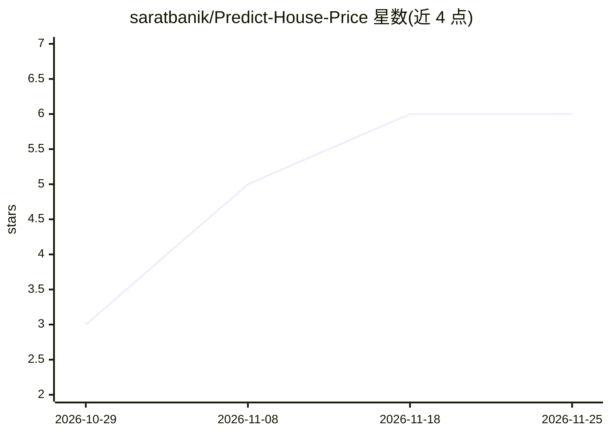

# saratbanik/Predict-House-Price

⭐ 6 · Python · 推送 2026-10-27 · [GitHub](https://github.com/saratbanik/Predict-House-Price) · 个人维护

**三特征线性回归预测房价的教学项目（Streamlit 界面）**

基于 scikit-learn Linear Regression 的房价预测教学项目，从居住面积、卧室数、卫生间数三个输入预测 Ames, Iowa 数据集的房屋售价（USD）。提供 Streamlit 网页界面与命令行预测脚本，训练流程采用 80/20 划分、中位数填补缺失值，输出 MAE/RMSE/R² 指标与残差诊断图。README 自述这是教学基线而非正式估值工具，仅用三个特征、不涵盖地段与房龄等因素，且数据为 Ames 历史成交，不适用于其他市场的当前房价。

## 筛选速览

| 维度 | 判定 | 备注 |
|---|---|---|
| AI 角色 | `ai-native` | 本体是模型或模型工具 |
| 许可风险 | `none` | — |
| 部署形态 | `library` | 以包/库形式分发 |
| 模型依赖 | — | README 未给出锁定关系 |
| 硬件要求 | — | 无带数字的原话,不猜 |
| 安装摩擦 | `low` | 无编译、无系统依赖或容器化 |
| 成熟度 | — | 结构信号不足 |

## 能力要点

- 线性回归 + 三特征输入预测房屋售价
- 80/20 训练测试划分，报告 MAE、RMSE、R²
- Streamlit 网页界面与命令行预测脚本双入口
- 生成实际值-预测值与残差诊断图表

## 适用场景

- 学习线性回归端到端流程（训练、评估、部署）
- 复现 Kaggle Ames Housing 基线实验
- 需要一个带 Web 界面的机器学习示例项目

## 场景标签

`教程课程` · 领域:学习与行业

## 证据(README 行号)

> L12: This project uses **Linear Regression** to predict a house's sale price from three inputs:
> L18: The target is `SalePrice`, recorded in **US dollars (USD)**. The model uses the Kaggle *House Prices — Advanced Reg
> L152: This project is a beginner-friendly baseline, not a production real-estate valuation system. It uses only three pr

## 星数曲线

2026-10-29 3 → 2026-11-25 6（+3）

---
*卡片 v1 · prompt 1.4 · 生成 2026-11-20 · 置信度 high · 依据 README sha `2a68a58c0149` · [字段定义](../../DATASET.md)*
