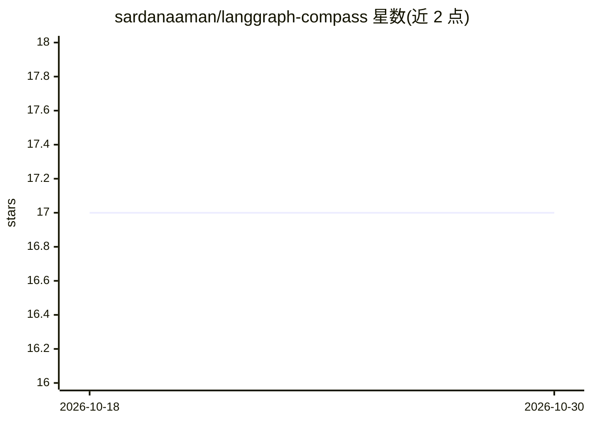

# sardanaaman/langgraph-compass

⭐ 17 · Python · Apache-2.0 · 推送 2026-02-02 · [GitHub](https://github.com/sardanaaman/langgraph-compass) · [官网](https://sardanaaman-langgraph-compass-demo.hf.space/) · 个人维护

**为 LangGraph agent 生成上下文相关追问的 Python 组件**

Compass 是一个可插入 LangGraph 图的 CompassNode 组件，用于在对话中生成后续追问。机制上分三步：触发策略决定是否生成（可跳过 guardrail 拦截、短回复等场景）、生成器按四种策略（adaptive/clarifying/exploratory/deepening）产出候选问题、排序器按新颖性与多样性过滤。支持通过 Send() 与主 agent 并行执行、用独立更小的模型生成以控制成本，并集成 LangSmith 追踪与 LangMem 用户习惯学习。面向构建对话式 agent 的开发者，pip 安装，Apache 2.0 许可。

## 筛选速览

| 维度 | 判定 | 备注 |
|---|---|---|
| AI 角色 | `ai-ecosystem` | LLM/agent 周边工具 |
| 许可风险 | `permissive` | Apache-2.0 |
| 部署形态 | `library` | 以包/库形式分发 |
| 模型依赖 | — | README 未给出锁定关系 |
| 硬件要求 | — | 无带数字的原话,不猜 |
| 安装摩擦 | `low` | 无编译、无系统依赖或容器化 |
| 成熟度 | — | 结构信号不足 |

## 能力要点

- LangGraph 节点形式的追问生成，触发/生成/排序三段流程
- 可配置触发策略与能力约束（只建议 agent 能实现的追问）
- Send() 并行执行避免增加响应延迟
- LangSmith 追踪集成与 LangMem 用户习惯个性化

## 适用场景

- 给我的对话 agent 自动生成引导用户的后续问题
- 在客服/销售对话中让 agent 主动推进对话
- 避免每轮重复相似的建议问题

## 场景标签

`Agent 框架` · 领域:Agent 开发

## 证据(README 行号)

> L8: **Intelligent follow-up question generation for LangGraph agents.**
> L46: Compass is a dedicated LangGraph node that gives you granular control over follow-up generation:

## 星数曲线

2026-10-18 17 → 2026-10-30 17（+0）

---
*卡片 v1 · prompt 1.4 · 生成 2026-10-29 · 置信度 high · 依据 README sha `449aec0b05d9` · [字段定义](../../DATASET.md)*
