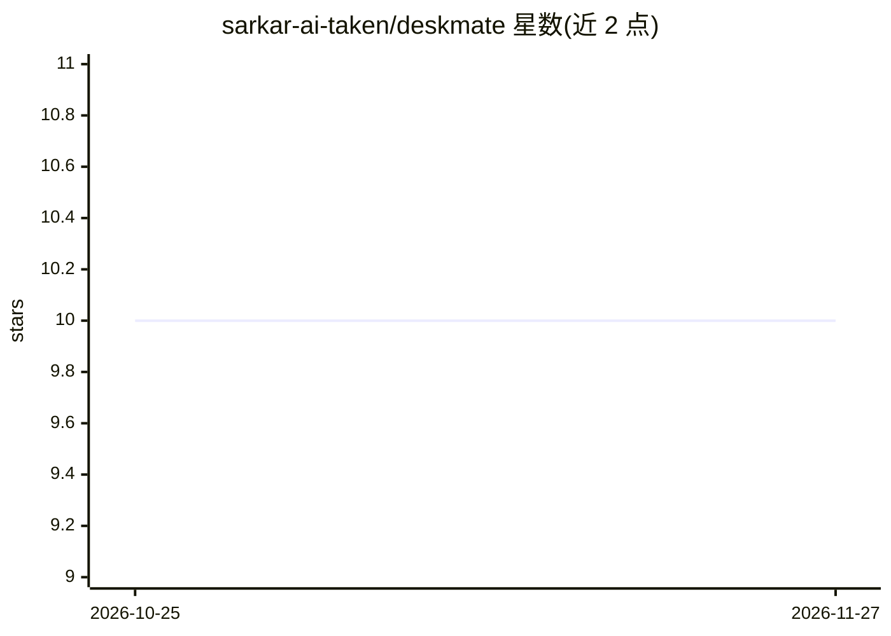

# sarkar-ai-taken/deskmate

⭐ 10 · TypeScript · MIT · 推送 2026-02-14 · [GitHub](https://github.com/sarkar-ai-taken/deskmate) · [官网](https://www.sarkar.ai/deskmate/) · 个人维护

**用自然语言通过 Telegram 远程控制本机的执行代理**

本地执行代理：通过 Telegram 发消息即可在本机执行命令、读写文件、截图。Gateway 为控制平面，消息平台是 I/O 适配器；代理后端支持 Claude Code（默认）、Codex、Gemini CLI、OpenCode，可经 AGENT_PROVIDER 切换。策略为 approve-by-default，保护文件夹与写操作需内联按钮确认；支持 MCP server、skills 工作流、cron 定时、健康检查、launchd/systemd 服务与 Docker 容器模式。限制：仅本机执行，不做多代理编排或自主长任务。

## 筛选速览

| 维度 | 判定 | 备注 |
|---|---|---|
| AI 角色 | `ai-native` | 本体是模型或模型工具 |
| 许可风险 | `permissive` | MIT |
| 部署形态 | `self-host` | docker 或自建部署 |
| 模型依赖 | locked-api |  |
| 硬件要求 | — | 无带数字的原话,不猜 |
| 安装摩擦 | `low` | 无编译、无系统依赖或容器化 |
| 成熟度 | — | 结构信号不足 |

## 能力要点

- 多通道 Gateway（Telegram 可用，Discord/Slack 规划中）+ 多代理后端切换
- MCP server 模式，将本机暴露为 Claude Desktop 等客户端的工具服务器
- approve-by-default 安全机制：保护文件夹、审批工作流、用户白名单、无开放端口
- skills 多步工作流与 cron 定时任务，结果回传聊天频道

## 适用场景

- 在外出时用 Telegram 查看磁盘、进程、日志并执行运维命令
- 远程触发测试、git 状态等开发操作
- 让 Claude Desktop 通过 MCP 直接操作本机
- 定时执行巡检任务并将结果推送到手机

## 场景标签

`AI 助手` · 领域:对话与助手

## 证据(README 行号)

> L10: Deskmate is a local execution agent that lets you control your personal machine using natural language and talks to
> L48: - **Multi-agent backends** — ships with Claude Code (default), Codex (OpenAI), Gemini CLI (Google), and OpenCode. S

## 星数曲线

2026-10-25 10 → 2026-11-27 10（+0）

---
*卡片 v1 · prompt 1.4 · 生成 2026-11-19 · 置信度 high · 依据 README sha `aec707deafbd` · [字段定义](../../DATASET.md)*
