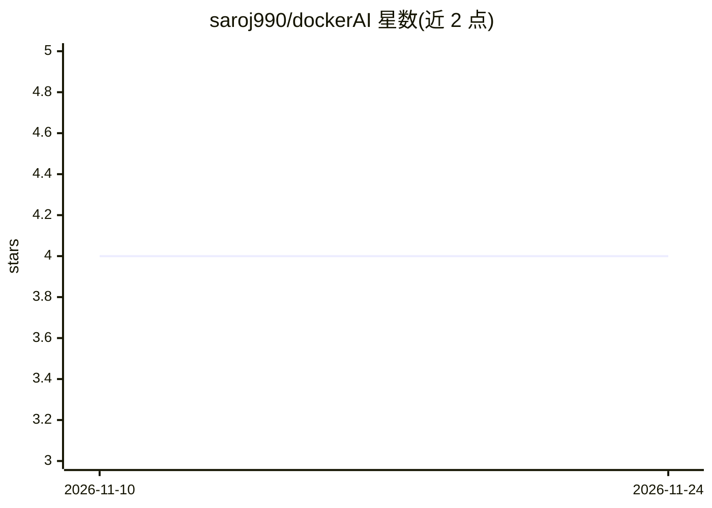

# saroj990/dockerAI

⭐ 4 · Python · 推送 2026-11-05 · [GitHub](https://github.com/saroj990/dockerAI) · 个人维护

**面向开发者：用自然语言/直接命令操作 Docker Engine 的本地 CLI agent**

dockai 是与 Docker Engine API 通信的命令行工具，支持自然语言问答与直接子命令两种方式管理容器：列表、日志、uptime、inspect、启停重启等。常见请求由本地意图管线在约 100-300ms 内解析，不调用模型；诊断类模糊问题才走 Ollama。安全机制：不执行模型输出的 shell 命令，仅调用固定 Docker 工具集，start/stop/restart/exec 需确认，delete/prune 直接拒绝。依赖 Python 3.11+ 与 Docker Engine；自然语言模式需 Ollama。

## 筛选速览

| 维度 | 判定 | 备注 |
|---|---|---|
| AI 角色 | `ai-ecosystem` | LLM/agent 周边工具 |
| 许可风险 | `none` | — |
| 部署形态 | `self-host` | docker 或自建部署 |
| 模型依赖 | local-ok | 支持本地模型 |
| 硬件要求 | — | 无带数字的原话,不猜 |
| 安装摩擦 | `low` | 无编译、无系统依赖或容器化 |
| 成熟度 | — | 结构信号不足 |

## 能力要点

- 本地意图管线先行：常见请求 ~100-300ms，模型不运行
- 不执行模型输出，仅限固定 Docker 工具，删除/清理操作拒绝
- 支持本地或远程 Ollama（可指向自有 GPU 主机），可完全离线
- 容器名模糊解析（空格、连字符、拼写错误）与会话焦点

## 适用场景

- 离线/隔离环境下用本地模型查询与诊断容器
- 通过对话查看容器日志、排查重启原因
- 脚本化执行容器启停等受限管理操作

## 场景标签

 · 领域:开发运维/容器管理

## 证据(README 行号)

> L3: Talk to your Docker Engine in plain English — or use fast direct commands with no model at all.
> L17: - **Fast path first.** Common asks ("show running containers", "logs for api-server") are resolved by a local inten
> L68: |**Docker Engine**|Container source of truth|`docker ps` (must work **without** sudo for your user)|

## 星数曲线

2026-11-10 4 → 2026-11-24 4（+0）

---
*卡片 v1 · prompt 1.4 · 生成 2026-11-21 · 置信度 mid · 依据 README sha `d51459c98bf5` · [字段定义](../../DATASET.md)*
