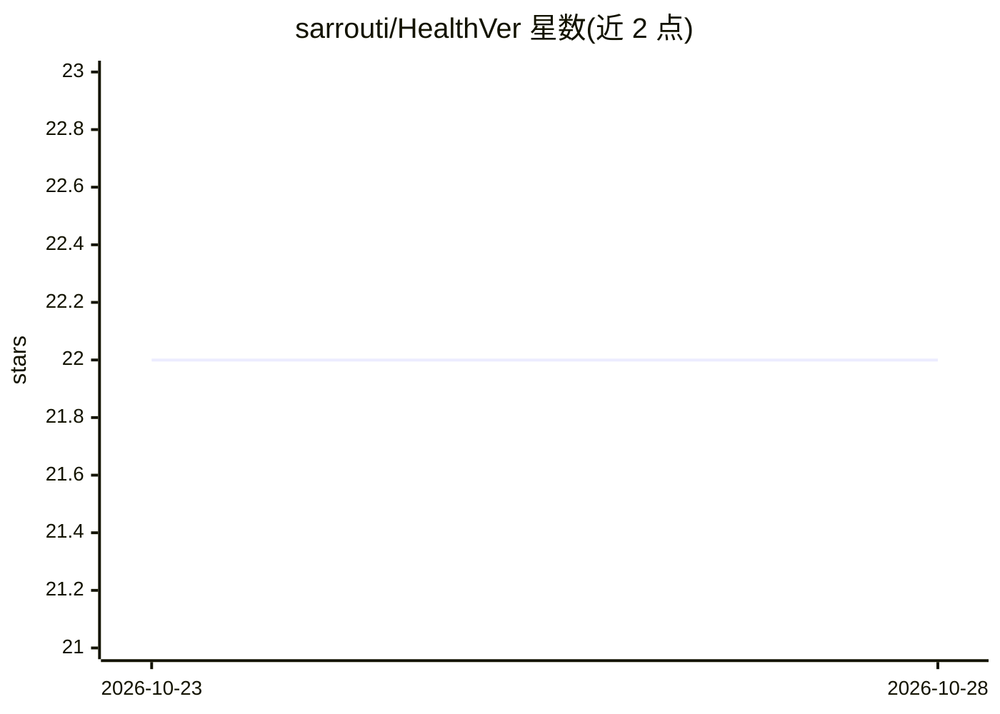

# sarrouti/HealthVer

⭐ 22 · Python · 推送 2026-10-21 · [GitHub](https://github.com/sarrouti/HealthVer) · 组织维护

**健康声明的循证事实核查数据集（14,330 对证据-声明）**

论文 Evidence-based Fact-Checking of Health-related Claims 的官方代码与数据集仓库。数据集用于核验真实世界健康声明（COVID-19 相关）相对于科学文献的真实性：声明来自搜索引擎返回片段，用 T5 相关性模型检索并重排科学论文，人工标注证据与声明关系为 Support/Refute/Neutral，共 14,330 对。附基于预训练语言模型的基线模型与排行榜（T5、SciBERT）。以 CC BY 4.0 发布，需引用论文。

## 筛选速览

| 维度 | 判定 | 备注 |
|---|---|---|
| AI 角色 | `ai-knowledge` | 知识聚合/清单类 |
| 许可风险 | `none` | — |
| 部署形态 | `None` |  |
| 模型依赖 | — | README 未给出锁定关系 |
| 硬件要求 | — | 无带数字的原话,不猜 |
| 安装摩擦 | `low` | 无编译、无系统依赖或容器化 |
| 成熟度 | — | 结构信号不足 |

## 能力要点

- 14,330 个人工标注的证据-声明对（Support/Refute/Neutral）
- 三步构建流程：真实声明检索、T5 重排科学文献、人工标注
- 提供基于预训练语言模型的基线模型与排行榜

## 适用场景

- 训练和评测健康声明的循证事实核查模型
- 研究真实世界医学声明上深度学习模型的表现
- 与健康类 misinformation 检测相关的研究实验

## 场景标签

`模型评测` · 领域:评测与运维

## 证据(README 行号)

> L3: This repository contains source code and the HealthVer dataset presented in the paper Evidence-based Fact-Checking o
> L6: In this paper, we introduce HealthVer a new dataset for evidence-based fact-checking of health-related claims that a

## 星数曲线

2026-10-23 22 → 2026-10-28 22（+0）

---
*卡片 v1 · prompt 1.4 · 生成 2026-10-27 · 置信度 high · 依据 README sha `1886565af257` · [字段定义](../../DATASET.md)*
