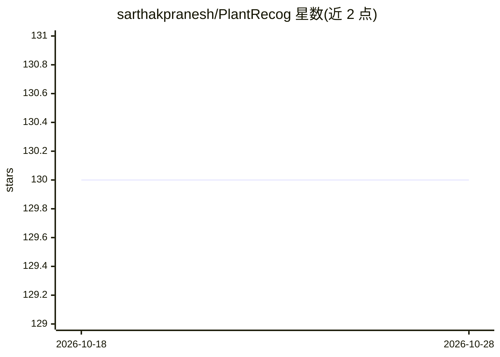

# sarthakpranesh/PlantRecog

⭐ 130 · TypeScript · MIT · 推送 2026-09-05 · [GitHub](https://github.com/sarthakpranesh/PlantRecog) · 个人维护

**免费花卉识别应用与可自托管识别 API 及模型**

提供花卉图像识别的一组服务：Android 应用（Google Play 与 GitHub Release 分发）、REST 识别服务端（Express，路由包括 /details 获取可识别类别、/predict 上传花卉图片返回 top-5 预测）以及模型，识别 299 种植物的花。服务端可由任何人自托管，用于构建自己的识别类应用；作者自托管实例仅供个人项目使用，生产环境需自建。

## 筛选速览

| 维度 | 判定 | 备注 |
|---|---|---|
| AI 角色 | `ai-native` | 本体是模型或模型工具 |
| 许可风险 | `permissive` | MIT |
| 部署形态 | `desktop` | 安装包/桌面程序 |
| 模型依赖 | — | README 未给出锁定关系 |
| 硬件要求 | — | 无带数字的原话,不猜 |
| 安装摩擦 | `low` | 无编译、无系统依赖或容器化 |
| 成熟度 | `idea` | |

## 能力要点

- 识别 299 种植物的花卉
- REST API：/predict 上传图片返回 top-5 预测
- 支持自托管服务端与模型

## 适用场景

- 在移动端拍摄花卉并获取识别结果
- 开发者自托管识别服务构建自己的植物应用
- 获取所有可识别植物类别列表用于客户端展示

## 场景标签

`目标检测` · 领域:感知与多模态

## 证据(README 行号)

> L3: The current version of the project is able to recognize 299 plants using their flowers. This flower recognition mode
> L19: |`post "/predict" content-type="multipart/form-data" parameter="image"`|`{"messages":"Success","payload":{"predicti

## 星数曲线

2026-10-18 130 → 2026-10-28 130（+0）

---
*卡片 v1 · prompt 1.4 · 生成 2026-10-22 · 置信度 high · 依据 README sha `697ceec7ec9e` · [字段定义](../../DATASET.md)*
