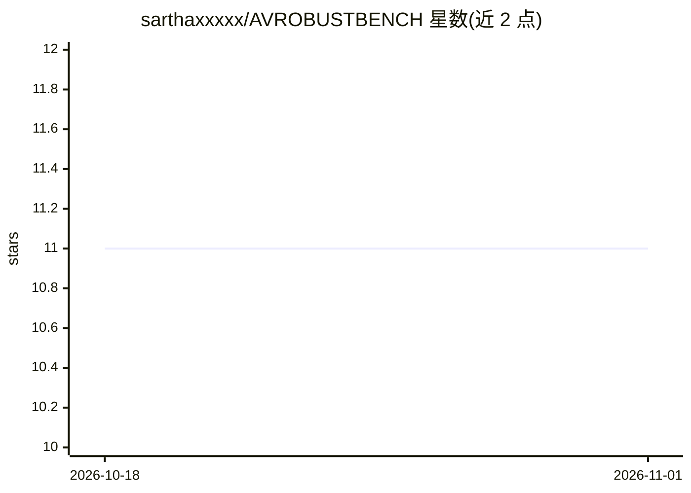

# sarthaxxxxx/AVROBUSTBENCH

⭐ 11 · Jupyter Notebook · MIT · 推送 2026-03-28 · [GitHub](https://github.com/sarthaxxxxx/AVROBUSTBENCH) · 组织维护

**音视频识别模型测试时鲁棒性基准（75 种相关双模态扰动）**

研究团队发布的音视频识别模型鲁棒性评测基准：提出 75 种同时作用于音频与视觉两模态且相关的扰动，构建 AUDIOSET-2C、VGGSOUND-2C、KINETICS-2C、EPICKITCHENS-2C 四个数据集，在 AudioSet、VGGSound、Kinetics-Sounds、Epic-Kitchens 测试集上添加扰动生成。提供模块化的 dataset.py 与 15 类扰动代码（gaussian/snow/rain 等，severity 1-5），可对任意音视频数据集加扰、生成损坏视频用于评测。需 Python 3.10+，数据集发布于 Hugging Face，附 Jupyter demo。面向音视频多模态研究者。

## 筛选速览

| 维度 | 判定 | 备注 |
|---|---|---|
| AI 角色 | `ai-ecosystem` | LLM/agent 周边工具 |
| 许可风险 | `permissive` | MIT |
| 部署形态 | `library` | 以包/库形式分发 |
| 模型依赖 | — | README 未给出锁定关系 |
| 硬件要求 | — | 无带数字的原话,不猜 |
| 安装摩擦 | `low` | 无编译、无系统依赖或容器化 |
| 成熟度 | — | 结构信号不足 |

## 能力要点

- 75 种跨音频与视觉双模态且相关的测试时扰动
- 四个数据集共 3 万余条音视频测试对，覆盖多领域
- dataset.py 模块化，可对任意音视频数据集添加 15 类扰动（severity 1-5）
- 提供从 mp4 生成损坏视频的静态函数与 demo.ipynb

## 适用场景

- 评测我的音视频识别模型在分布偏移下的鲁棒性
- 在自己的数据集上叠加音视频联合扰动构造测试集
- 生成损坏视频用于模型预处理或可视化分析

## 场景标签

`模型评测` · 领域:评测与运维

## 证据(README 行号)

> L1: # $\texttt{AVROBUSTBENCH}$: Benchmarking the Robustness of Audio-Visual Recognition Models at Test-Time
> L13: While recent audio-visual recognition models have demonstrated impressive performance, their robustness to distribu
> L18: We release the code and datasets comprising $\texttt{AVROBUSTBENCH}$. We propose four audio-visual datasets, $\text

## 星数曲线

2026-10-18 11 → 2026-11-01 11（+0）

---
*卡片 v1 · prompt 1.4 · 生成 2026-11-01 · 置信度 mid · 依据 README sha `c106a7462714` · [字段定义](../../DATASET.md)*
