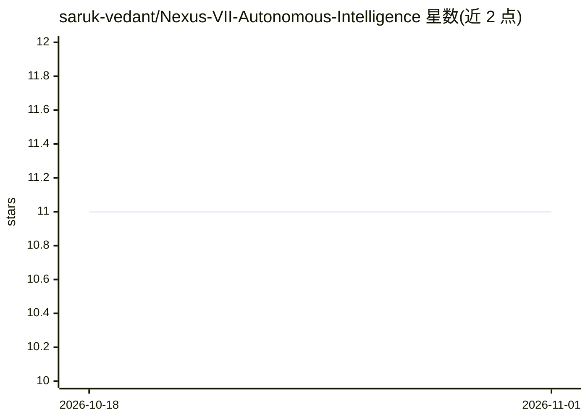

# saruk-vedant/Nexus-VII-Autonomous-Intelligence

⭐ 11 · Python · MIT · 推送 2026-09-11 · [GitHub](https://github.com/saruk-vedant/Nexus-VII-Autonomous-Intelligence) · [官网](https://github.com/saruk-vedant/Nexus-VII-Autonomous-Intelligence) · 个人维护

**桌面端 J.A.R.V.I.S. 式自主语音 AI 助手**

基于 Python/FastAPI/WebSockets 的 Windows 桌面自主 AI 助手：唤醒词激活、实时语音识别（Whisper on Groq 或 Google STT 兜底）加 Edge TTS 语音回复；支持多 AI 提供商神经热切换（最多 5 个备用，限流时自动切换）、截图视觉分析、RAG 向量长期记忆、后台主动引擎与分心提醒。集成 Telegram 远程控制、Gmail、Google Calendar/Drive、Spotify、Playwright 网页表单自动填写，并可执行文件系统与系统级操作（带危险操作确认门）。提供可扩展技能系统，从源码运行。

## 筛选速览

| 维度 | 判定 | 备注 |
|---|---|---|
| AI 角色 | `ai-native` | 本体是模型或模型工具 |
| 许可风险 | `permissive` | MIT |
| 部署形态 | `library` | 以包/库形式分发 |
| 模型依赖 | — | README 未给出锁定关系 |
| 硬件要求 | — | 无带数字的原话,不猜 |
| 安装摩擦 | `low` | 无编译、无系统依赖或容器化 |
| 成熟度 | — | 结构信号不足 |

## 能力要点

- 唤醒词+语音控制+Edge TTS 语音交互
- 多 AI 提供商神经热切换（最多 5 个备用提供商）
- RAG 向量长期记忆与后台主动提醒引擎
- Telegram 远程控制与 Playwright 网页表单自动化

## 适用场景

- 用语音在桌面端操控电脑、查邮件和日程
- 让助手后台监控目标并在分心时经 Telegram 提醒
- 让助手截图分析屏幕或自动填写网页表单

## 场景标签

`语音 Agent` `AI 助手` `浏览器自动化` · 领域:效率与自动化

## 证据(README 行号)

> L3: **A J.A.R.V.I.S.-inspired autonomous AI assistant with voice control, Telegram integration, proactive reminders, web
> L17: |**🎙️ Voice Control**|Speak to your assistant using real-time speech recognition and human-like TTS responses.|
> L58: Jarvis doesn't depend on a single AI provider. If your primary provider (e.g., Google Gemini) hits a rate limit (HT

## 星数曲线

2026-10-18 11 → 2026-11-01 11（+0）

---
*卡片 v1 · prompt 1.4 · 生成 2026-11-01 · 置信度 mid · 依据 README sha `aa4faeb37c99` · [字段定义](../../DATASET.md)*
