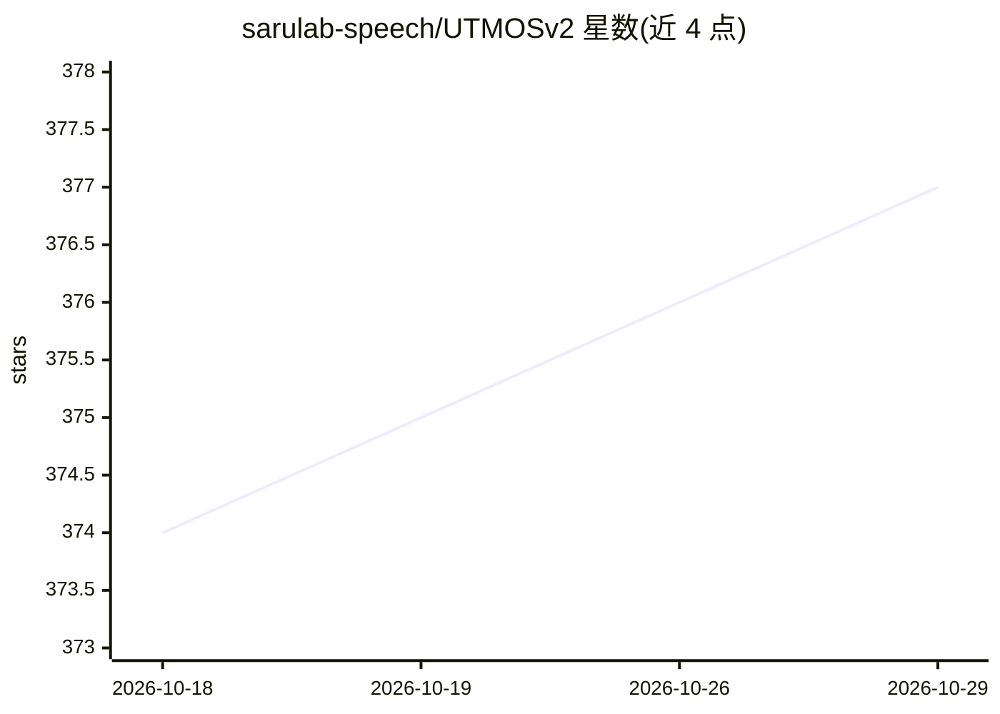

# sarulab-speech/UTMOSv2

⭐ 377 · Python · MIT · 推送 2026-04-02 · [GitHub](https://github.com/sarulab-speech/UTMOSv2) · 组织维护

**预测合成语音自然度 MOS 的模型与 Python 库**

UTokyo-SaruLab 的 MOS（平均意见分）预测系统官方实现，VoiceMOS Challenge 2024 Track1 T05 系统：从深度图像分类器迁移学习，对高质量合成语音预测自然度 MOS。提供预训练模型与 Python 库，可对张量、单个 wav 文件或目录批量预测 MOS，输出 float 或 CSV；另提供推理脚本、自训练指南与数据集文档。以 GitHub 源码安装（uv/pip），附 arXiv 论文与 Hugging Face Space 演示。

## 筛选速览

| 维度 | 判定 | 备注 |
|---|---|---|
| AI 角色 | `ai-native` | 本体是模型或模型工具 |
| 许可风险 | `permissive` | MIT |
| 部署形态 | `library` | 以包/库形式分发 |
| 模型依赖 | — | README 未给出锁定关系 |
| 硬件要求 | — | 无带数字的原话,不猜 |
| 安装摩擦 | `low` | 无编译、无系统依赖或容器化 |
| 成熟度 | — | 结构信号不足 |

## 能力要点

- 预训练模型直接预测 MOS（Python API 与推理脚本两种方式）
- 支持单个 wav、目录批量与内存张量三种输入，默认采样率 16000 Hz
- 提供自行训练的指南与所使用数据集文档
- SLT 2024 论文发表，VoiceMOS Challenge 2024 Track1 参赛系统

## 适用场景

- 评估语音合成系统的自然度而无需人工评分
- 批量预测 wav 文件的 MOS 并导出 CSV
- 在 Python 流水线中集成 MOS 预测做语音质量评测

## 场景标签

`模型评测` · 领域:评测与运维

## 证据(README 行号)

> L9:  “The T05 System for The VoiceMOS Challenge 2024:
> L10:  Transfer Learning from Deep Image Classifier to Naturalness MOS Prediction of High-Quality Synthetic Speech”
> L73:       mos = model.predict(data=data, sr=16000) # Returns a torch.Tensor or np.ndarray with shape (batch_size,) or (

## 星数曲线

2026-10-18 374 → 2026-10-29 377（+3）

---
*卡片 v1 · prompt 1.4 · 生成 2026-10-21 · 置信度 high · 依据 README sha `1d2d89cfdcba` · [字段定义](../../DATASET.md)*
