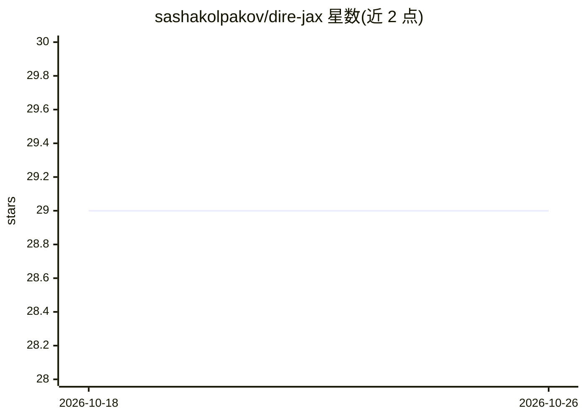

# sashakolpakov/dire-jax

⭐ 29 · Python · Apache-2.0 · 推送 2025-11-21 · [GitHub](https://github.com/sashakolpakov/dire-jax) · [官网](https://arxiv.org/abs/2503.03156) · 个人维护

**基于 JAX 的降维库：保持全局结构的高维数据可视化**

Python 降维包 DiRe，用随机投影加基于度量的图方法将高维嵌入映射到低维，目标为保持数据集全局结构。基于 JAX 实现，支持 CPU/GPU/TPU，提供 JIT 向量化计算、混合精度、内存分块与大数集模式（>65K 点自动内存管理），作者声明针对小中规模数据集（<50K 点）优化。以 pip 安装，附带基准工具与示例，配有 arXiv 论文与 JOSS DOI。

## 筛选速览

| 维度 | 判定 | 备注 |
|---|---|---|
| AI 角色 | `ai-native` | 本体是模型或模型工具 |
| 许可风险 | `permissive` | Apache-2.0 |
| 部署形态 | `library` | 以包/库形式分发 |
| 模型依赖 | — | README 未给出锁定关系 |
| 硬件要求 | — | 无带数字的原话,不猜 |
| 安装摩擦 | `low` | 无编译、无系统依赖或容器化 |
| 成熟度 | — | 结构信号不足 |

## 能力要点

- 基于 JAX 的向量化计算与 JIT 编译
- 混合精度算术与内核缓存
- 大数集模式：>65K 点自动内存管理
- 附带降维质量度量与基准工具（pip install dire-jax[utils]）

## 适用场景

- 将高维嵌入降至 2D/3D 用于数据可视化
- 希望保持全局结构的数据探索
- 对降维结果做质量评估与基准测试

## 场景标签

 · 领域:机器学习/数据科学

## 证据(README 行号)

> L30: ### A high-performance DImensionality REduction package with JAX
> L32: DiRe offers fast dimensionality reduction preserving the global dataset structure, with benchmarks showing competit

## 星数曲线

2026-10-18 29 → 2026-10-26 29（+0）

---
*卡片 v1 · prompt 1.4 · 生成 2026-10-26 · 置信度 high · 依据 README sha `c5755aacc93b` · [字段定义](../../DATASET.md)*
