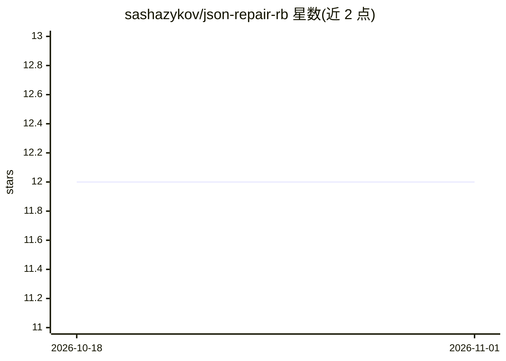

# sashazykov/json-repair-rb

⭐ 12 · Ruby · NOASSERTION · 推送 2026-06-17 · [GitHub](https://github.com/sashazykov/json-repair-rb) · [官网](https://rubygems.org/gems/json-repair) · 个人维护

**Ruby 库：修复 LLM 输出等来源的损坏 JSON 字符串**

基于 jsonrepair JS 库思路实现的 Ruby gem，读取含缺失引号、多余逗号、未加引号键、Markdown 代码围栏、NDJSON、注释等问题的 JSON 字符串，输出修复后的规范化 JSON；也可通过 return_objects 直接返回解析后的 Ruby 值。面向处理 LLM 输出的 Ruby 开发者，提供 repair_file/repair_io 读取文件与 IO，并附带 json-repair 命令行可执行文件，支持 stdin、文件输入与原地覆写。ISC 许可。

## 筛选速览

| 维度 | 判定 | 备注 |
|---|---|---|
| AI 角色 | `ai-ecosystem` | LLM/agent 周边工具 |
| 许可风险 | `none` | NOASSERTION |
| 部署形态 | `None` |  |
| 模型依赖 | — | README 未给出锁定关系 |
| 硬件要求 | — | 无带数字的原话,不猜 |
| 安装摩擦 | `low` | 无编译、无系统依赖或容器化 |
| 成熟度 | — | 结构信号不足 |

## 能力要点

- 修复缺失引号/逗号、未引号键、Markdown 围栏、NDJSON、注释等损坏 JSON
- 输出规范化形式：空白折叠、数字规范化、\uXXXX 解码、重复键 last-write-wins
- repair_file/repair_io 支持从文件与任意 IO 对象读取
- 附带 json-repair CLI，支持 stdin/文件输入、--output 与 --overwrite

## 适用场景

- 我在 Ruby 应用中解析 LLM 返回的不合规 JSON 输出
- 我需要批量修复磁盘上损坏的 JSON 文件并原地覆写
- 我把多行 Markdown 列表输出规整为 JSON 数组

## 场景标签

 · 领域:开发者工具/LLM 输出处理

## 证据(README 行号)

> L3: This is a Ruby gem designed to repair broken JSON strings. Inspired by and based on the jsonrepair js library. It ef
> L34: Markdown markup in LLM output is handled too: fenced code blocks like `` ```json `` are stripped, and list markers 

## 星数曲线



2026-10-18 12 → 2026-11-01 12（+0）


---
*卡片 v1 · prompt 1.4 · 生成 2026-11-01 · 置信度 high · 依据 README sha `53f4a46d3aa7` · [字段定义](../../DATASET.md)*
