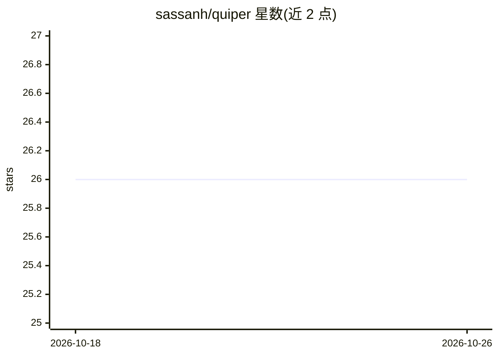

# sassanh/quiper

⭐ 26 · Swift · MIT · 推送 2026-10-25 · [GitHub](https://github.com/sassanh/quiper) · [官网](https://quiper.sassanh.com) · 个人维护

**macOS 全局热键悬浮窗，聚合 ChatGPT/Claude 等 AI 网页应用**

基于纯 AppKit 的 macOS 悬浮覆盖层（⌥Space 呼出），把 ChatGPT、Claude、Gemini、DeepSeek、Kimi、Qwen 等云端 AI 服务及 llama.cpp、Open WebUI 等自托管服务封装为桌面体验：每个引擎保持 10 个持久会话槽，可注入自定义 CSS 与 JavaScript 动作。敏感引擎可用 TouchID 锁定，本地数据以 AES-256 APFS sparsebundle 加密（仅本地保护，云端不加密）。内置 EasyList/EasyPrivacy 广告追踪拦截，MIT 开源、无遥测。要求 macOS 14.6+，提供 dmg 安装包或 Xcode 16+ 源码构建。

## 筛选速览

| 维度 | 判定 | 备注 |
|---|---|---|
| AI 角色 | `ai-enhanced` | 去掉 AI 部分产品仍成立 |
| 许可风险 | `permissive` | MIT |
| 部署形态 | `desktop` | 安装包/桌面程序 |
| 模型依赖 | locked-api |  |
| 硬件要求 | — | 无带数字的原话,不猜 |
| 安装摩擦 | `medium` | 含编译或系统依赖之一 |
| 成熟度 | — | 结构信号不足 |

## 能力要点

- ⌥Space 全局热键悬浮窗，不占 Dock，跨引擎 10 个持久会话槽
- TouchID 生物识别锁定引擎，本地数据 AES-256 APFS sparsebundle 加密
- 内置 EasyList/EasyPrivacy 广告与追踪拦截，默认开启
- 支持 llama.cpp / Open WebUI / oMLX 等本地自托管引擎

## 适用场景

- 在任意应用上方快速呼出 AI 对话，不切换窗口打断工作流
- 把多个 AI 服务整合为一个 Spotlight 式桌面入口并保持会话
- 用 TouchID 锁定敏感 AI 对话，防止本机被窥探

## 场景标签

`聊天机器人` `AI 助手` · 领域:对话与助手

## 证据(README 行号)

> L3: Quiper unifies all your AI chat services into a single, instant-access macOS overlay. A global hotkey drops you into
> L33: Quiper ships with one-click templates for the most popular AI chat services — cloud and local — so the engine you a
> L47: |Open WebUI|Open source · self-hosted|A native Open WebUI desktop client for Mac — point it at your own server and 

## 星数曲线

2026-10-18 26 → 2026-10-26 26（+0）

---
*卡片 v1 · prompt 1.4 · 生成 2026-10-26 · 置信度 high · 依据 README sha `11efce1a261f` · [字段定义](../../DATASET.md)*
