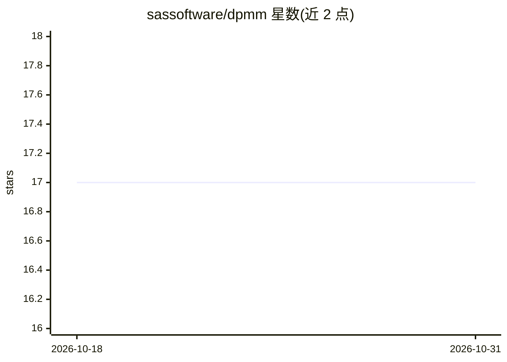

# sassoftware/dpmm

⭐ 17 · Python · Apache-2.0 · 推送 2026-09-04 · [GitHub](https://github.com/sassoftware/dpmm) · [官网](https://arxiv.org/abs/2506.00322) · 组织维护

**生成合成表格数据的 Python 库，端到端差分隐私保障**

SAS 维护的 Python 库，实现差分隐私边际模型（PrivBayes+PGM、MST、AIM）生成合成表格数据。提供端到端 DP 流水线：DP 数据预处理（数据域提取、PrivTree/Uniform 离散化）、select-measure-generate 范式的生成模型、DP 机制审计。支持 pandas 多数据类型、缺失值、条件生成、确定性生成、模型序列化。README 声明面向研究与探索用途（如保留 1/2 阶边际、至多 32 特征数据集），不面向复杂生产场景。

## 筛选速览

| 维度 | 判定 | 备注 |
|---|---|---|
| AI 角色 | `ai-native` | 本体是模型或模型工具 |
| 许可风险 | `permissive` | Apache-2.0 |
| 部署形态 | `library` | 以包/库形式分发 |
| 模型依赖 | — | README 未给出锁定关系 |
| 硬件要求 | — | 无带数字的原话,不猜 |
| 安装摩擦 | `low` | 无编译、无系统依赖或容器化 |
| 成熟度 | — | 结构信号不足 |

## 能力要点

- 端到端差分隐私流水线（预处理、生成模型、机制审计）
- 实现 PrivBayes+PGM、MST、AIM 三类 DP 边际模型
- 支持条件生成、确定性生成与模型序列化
- DP 离散化（PrivTree/Uniform/auto）与域压缩控制隐私预算

## 适用场景

- 在不泄露个体隐私的前提下生成可用的人工合成表格数据
- 研究差分隐私合成数据生成方法与机制审计
- 保留原始数据边际分布的隐私保护数据发布实验

## 场景标签

 · 领域:差分隐私/合成数据

## 证据(README 行号)

> L9: _dpmm_ is a Python library that implements state-of-the-art Differentially Private Marginal Models for generating sy
> L21: __NB: Intended Use -- _dpmm_ is designed for research and exploratory use in privacy-preserving synthetic data gene
> L145: If you use this code, please cite the associated paper:

## 星数曲线

2026-10-18 17 → 2026-10-31 17（+0）

---
*卡片 v1 · prompt 1.4 · 生成 2026-10-29 · 置信度 high · 依据 README sha `37dbda1d469c` · [字段定义](../../DATASET.md)*
