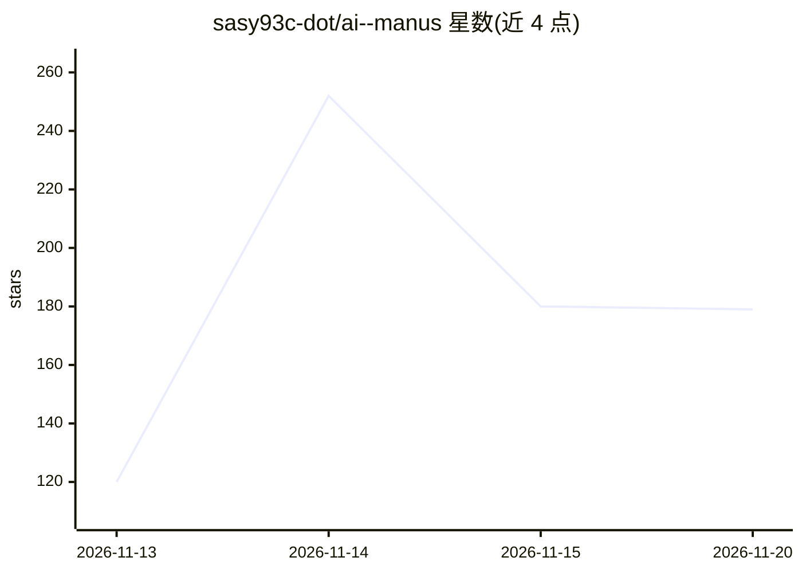

# sasy93c-dot/ai--manus

⭐ 179 · Apache-2.0 · 推送 2026-11-17 · [GitHub](https://github.com/sasy93c-dot/ai--manus) · 个人维护

**面向个人用户的自主 AI Agent：代跑代码与控制浏览器**

README 以营销文案形式描述一个通用自主 AI Agent：用户以自然语言下达任务，代理自行编写并执行脚本、打开网页、填写表单、跨脚本与浏览器完成多步操作，可记忆工作流模式在后续会话复用。定位为家庭、学习与轻量办公场景的个人助手，非企业平台。文中给出 CPU/内存等硬件兼容表和六步上手流程，但未提供任何安装命令、下载链接的正文说明或代码仓库结构信息。

## 筛选速览

| 维度 | 判定 | 备注 |
|---|---|---|
| AI 角色 | `ai-native` | 本体是模型或模型工具 |
| 许可风险 | `permissive` | Apache-2.0 |
| 部署形态 | `None` |  |
| 模型依赖 | — | README 未给出锁定关系 |
| 硬件要求 | — | 无带数字的原话,不猜 |
| 安装摩擦 | `low` | 无编译、无系统依赖或容器化 |
| 成熟度 | — | 结构信号不足 |

## 能力要点

- 自主执行代码并控制浏览器完成多步任务
- 任务模式可跨会话记忆复用
- 定位家庭/学习/轻量办公的小规模场景
- README 列出最低/推荐硬件兼容表

## 适用场景

- 让代理代为查网页、填表、收集资料
- 自动运行小脚本替代重复操作
- 学生整理研究笔记与快速计算

## 场景标签

`AI 助手` `浏览器自动化` `编码 Agent` · 领域:效率与自动化

## 证据(README 行号)

> L10: - **Autonomous Code Execution:** Manus AI agent runs code on its own to complete tasks, so you can focus on decisio
> L18: Manus is an autonomous AI agent designed to run code and control a browser on your behalf. Instead of acting like a

## 星数曲线

2026-11-13 120 → 2026-11-20 179（+59）

---
*卡片 v1 · prompt 1.4 · 生成 2026-11-18 · 置信度 low · 依据 README sha `0eccc6fbe733` · [字段定义](../../DATASET.md)*
