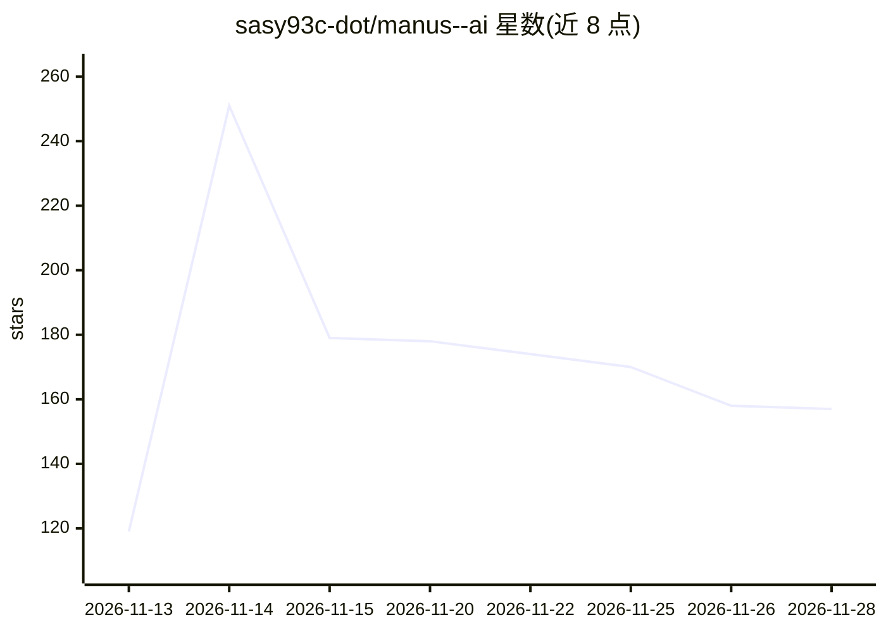

# sasy93c-dot/manus--ai

⭐ 157 · Apache-2.0 · 推送 2026-11-17 · [GitHub](https://github.com/sasy93c-dot/manus--ai) · 个人维护

**面向个人用户的自主 AI Agent：代跑代码与操控浏览器**

自称 Manus 的自主 AI 代理产品介绍页，宣称代理可自行编写并执行脚本、操控浏览器（导航、填表、抓取信息），完成多步骤任务，定位为家庭、学习与轻量办公场景的个人助手，而非企业平台。README 仅包含功能描述、硬件兼容表（最低 4GB 内存、双核 CPU）与上手步骤说明，未提供任何安装命令、源码入口、模型接入方式或技术实现细节；含 'PROMO2026' 推广字样与关键词堆砌段落。

## 筛选速览

| 维度 | 判定 | 备注 |
|---|---|---|
| AI 角色 | `ai-native` | 本体是模型或模型工具 |
| 许可风险 | `permissive` | Apache-2.0 |
| 部署形态 | `None` |  |
| 模型依赖 | — | README 未给出锁定关系 |
| 硬件要求 | — | 无带数字的原话,不猜 |
| 安装摩擦 | `low` | 无编译、无系统依赖或容器化 |
| 成熟度 | — | 结构信号不足 |

## 能力要点

- 宣称代理可自主执行代码与操控浏览器完成多步任务
- 定位家庭、学习、轻量办公场景，无技术门槛
- README 给出最低/推荐硬件兼容表（4GB RAM 起）
- 未提供安装命令或技术实现说明

## 适用场景

- 让代理代为完成网页信息收集与表单填写
- 自动运行小脚本与文件整理等重复任务
- 学生组织研究资料、跑快速计算

## 场景标签

`AI 助手` `浏览器自动化` · 领域:效率与自动化

## 证据(README 行号)

> L10: - **Autonomous Code Execution:** Manus AI agent runs code on its own to complete tasks, so you can focus on decisio
> L18: Manus is an autonomous AI agent designed to run code and control a browser on your behalf. Instead of acting like a

## 星数曲线

2026-11-13 119 → 2026-11-28 157（+38）

---
*卡片 v1 · prompt 1.4 · 生成 2026-11-18 · 置信度 low · 依据 README sha `0eccc6fbe733` · [字段定义](../../DATASET.md)*
