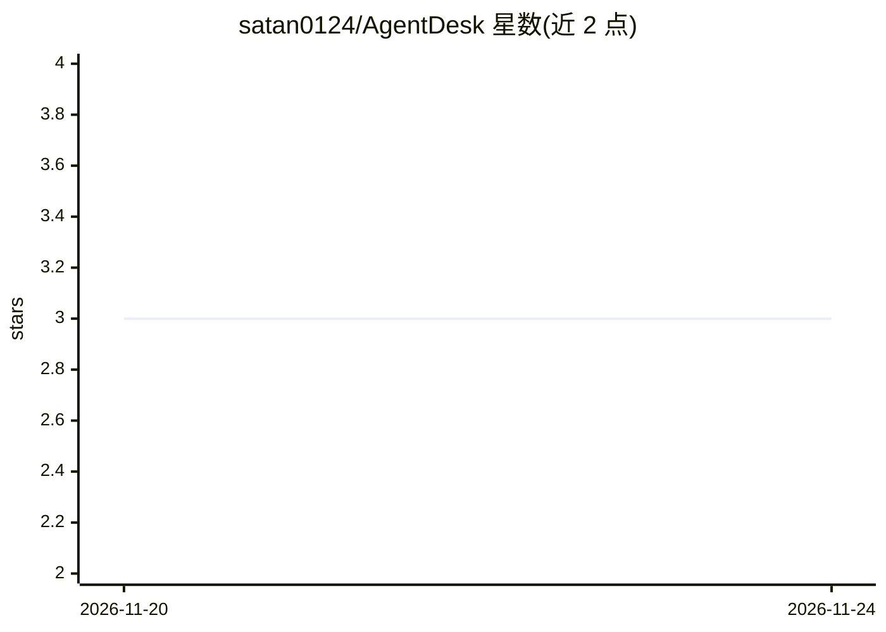

# satan0124/AgentDesk

⭐ 4 · JavaScript · MIT · 推送 2026-11-20 · [GitHub](https://github.com/satan0124/AgentDesk) · 个人维护 · 中文 README

**Windows 桌面应用：在统一聊天中管理多个 CLI 编码 agent**

把 Claude Code、Codex CLI、Cursor Agent CLI 及自定义 CLI agent 汇入同一 Windows 桌面工作区。同一会话内切换 agent 并自动补发新 agent 错过的消息，Claude 可通过内置工具将任务委托给其他 agent，过程与结果以卡片实时展示。会话可压缩为可搜索索引降低每请求重复 token；聊天/工作双模式限制文件编辑；进度文件支持跨会话续接。应用本身不内置模型，需已安装并登录相应 CLI（Claude Code 必需，其余可选）。

## 筛选速览

| 维度 | 判定 | 备注 |
|---|---|---|
| AI 角色 | `ai-ecosystem` | LLM/agent 周边工具 |
| 许可风险 | `permissive` | MIT |
| 部署形态 | `library` | 以包/库形式分发 |
| 模型依赖 | — | README 未给出锁定关系 |
| 硬件要求 | — | 无带数字的原话,不猜 |
| 安装摩擦 | `low` | 无编译、无系统依赖或容器化 |
| 成熟度 | — | 结构信号不足 |

## 能力要点

- 同一会话内切换多个 CLI agent 并自动补发上下文
- Claude 委托任务给 Codex/Cursor 并展示过程卡片
- 会话压缩为索引 + 编号 transcript，降低重复 token
- 聊天/工作模式分离，可添加自定义 CLI agent

## 适用场景

- 在同一窗口协调使用多个编码 agent
- 长会话中压缩上下文减少 token 消耗
- 讨论阶段限制编辑，确认后再切到工作模式改文件
- 跨会话续接长任务进度

## 场景标签

`多智能体` `编码 Agent` · 领域:Agent 开发

## 证据(README 行号)

> L9: AgentDesk puts Claude Code, Codex CLI, Cursor Agent CLI and other CLI agents you configure into one Windows app. Swi
> L11: > Windows 10 / 11 only. Claude Code is required; the other CLIs are optional. AgentDesk bundles no AI model: it run
> L59: - Only Claude Code is enabled by default. Add others under **Add another CLI agent** at the bottom of Settings, whe

## 星数曲线

2026-11-20 3 → 2026-11-24 3（+0）

---
*卡片 v1 · prompt 1.4 · 生成 2026-11-21 · 置信度 high · 依据 README sha `c7415596c724` · [字段定义](../../DATASET.md)*
