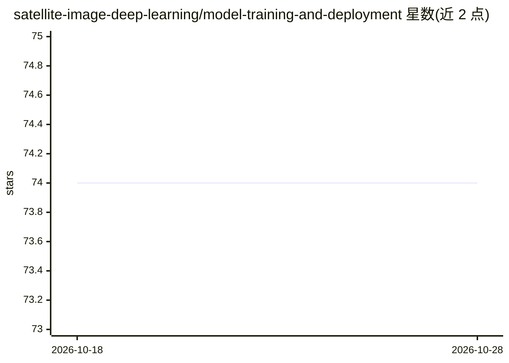

# satellite-image-deep-learning/model-training-and-deployment

⭐ 74 · Apache-2.0 · 推送 2026-10-26 · [GitHub](https://github.com/satellite-image-deep-learning/model-training-and-deployment) · 组织维护

**卫星与航空影像深度学习模型训练与部署的实践指南清单**

satellite-image-deep-learning 系列的模型训练与部署知识页：汇总多波段影像训练适配、切片/滑窗推理、数据增强、指标选择（IoU/mAP/F1）等最佳实践条目；梳理 Colab/Kaggle 免费 GPU 环境、REST API/gRPC/TorchServe/框架专用与通用模型服务方案，并链接相关教程与开源项目。条目以外部链接为主，不提供可运行代码或安装包，属于策展式参考资源。

## 筛选速览

| 维度 | 判定 | 备注 |
|---|---|---|
| AI 角色 | `ai-knowledge` | 知识聚合/清单类 |
| 许可风险 | `permissive` | Apache-2.0 |
| 部署形态 | `None` |  |
| 模型依赖 | — | README 未给出锁定关系 |
| 硬件要求 | — | 无带数字的原话,不猜 |
| 安装摩擦 | `medium` | 含编译或系统依赖之一 |
| 成熟度 | — | 结构信号不足 |

## 能力要点

- 覆盖多波段影像训练适配与滑窗大图推理方法
- 整理 Precision/Recall/F1/IoU/mAP 等指标定义与适用性说明
- 汇总 Colab/Kaggle 免费云 GPU 训练环境信息
- 按 REST API、gRPC、TorchServe、框架专用/通用分类梳理部署方案

## 适用场景

- 训练遥感影像分类/检测/分割模型前查阅实践要点
- 选择云端 GPU 训练环境与模型服务部署方案
- 理解卫星大图切片推理与指标选择的常见做法

## 场景标签

`精选清单` · 领域:学习与行业

## 证据(README 行号)

> L5:  Training and deployment of deep learning models applied to satellite and aerial imagery.
> L9: # Model training best practice
> L85: # Model deployment

## 星数曲线

2026-10-18 74 → 2026-10-28 74（+0）

---
*卡片 v1 · prompt 1.4 · 生成 2026-10-24 · 置信度 high · 依据 README sha `f77deab281bf` · [字段定义](../../DATASET.md)*
