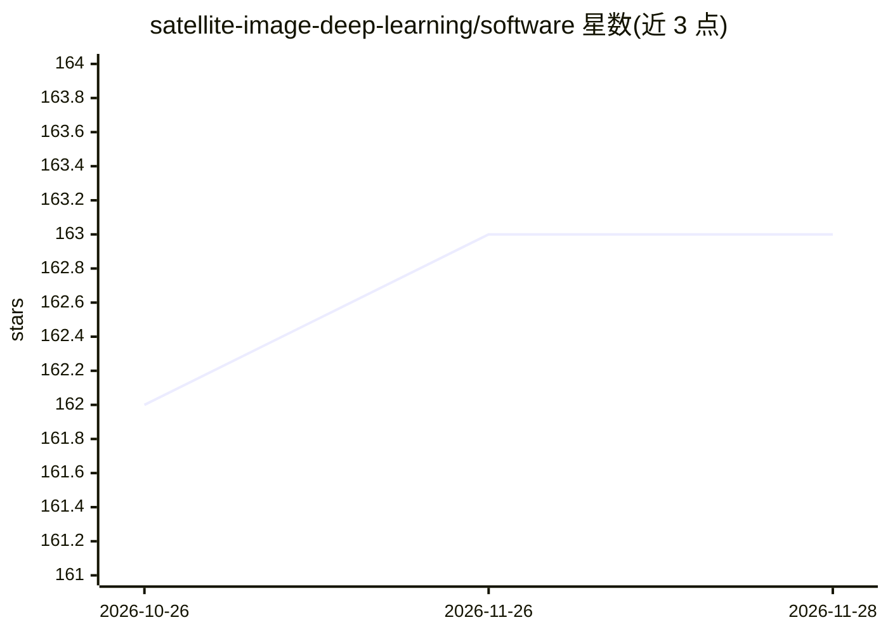

# satellite-image-deep-learning/software

⭐ 163 · Apache-2.0 · 推送 2026-11-21 · [GitHub](https://github.com/satellite-image-deep-learning/software) · 个人维护

**卫星与航空影像 ML 工具策展清单，按任务分类收录**

一个收录卫星与航空影像机器学习软件的策展清单，按深度学习框架、数据集创建、影像切片与预测合并等类别组织条目，每条附一句功能描述，部分条目标注维护状态（如自 2019/2020 年起无活动、不再维护）。用法为在页面中检索（Control+F）查找特定论文或工具。README 本身不含安装流程，条目均指向各上游项目。

## 筛选速览

| 维度 | 判定 | 备注 |
|---|---|---|
| AI 角色 | `ai-knowledge` | 知识聚合/清单类 |
| 许可风险 | `permissive` | Apache-2.0 |
| 部署形态 | `library` | 以包/库形式分发 |
| 模型依赖 | — | README 未给出锁定关系 |
| 硬件要求 | — | 无带数字的原话,不猜 |
| 安装摩擦 | `medium` | 含编译或系统依赖之一 |
| 成熟度 | — | 结构信号不足 |

## 能力要点

- 按深度学习框架、数据集创建、切片/合并等类别组织条目
- 标注部分条目的维护状态（无活动/不再维护）
- 支持在页面内按论文或工具名检索

## 适用场景

- 查找处理卫星影像的深度学习框架
- 寻找下载 Sentinel/Landsat 等卫星数据的工具
- 为切片标注与训练寻找影像切分工具

## 场景标签

`精选清单` · 领域:学习与行业

## 证据(README 行号)

> L5:  Software for working with satellite & aerial imagery ML datasets.
> L9: **How to use this repository:** if you know exactly what you are looking for (e.g. you have the paper name) you can 

## 星数曲线

2026-10-26 162 → 2026-11-28 163（+1）

---
*卡片 v1 · prompt 1.4 · 生成 2026-11-27 · 置信度 mid · 依据 README sha `63cc263facab` · [字段定义](../../DATASET.md)*
