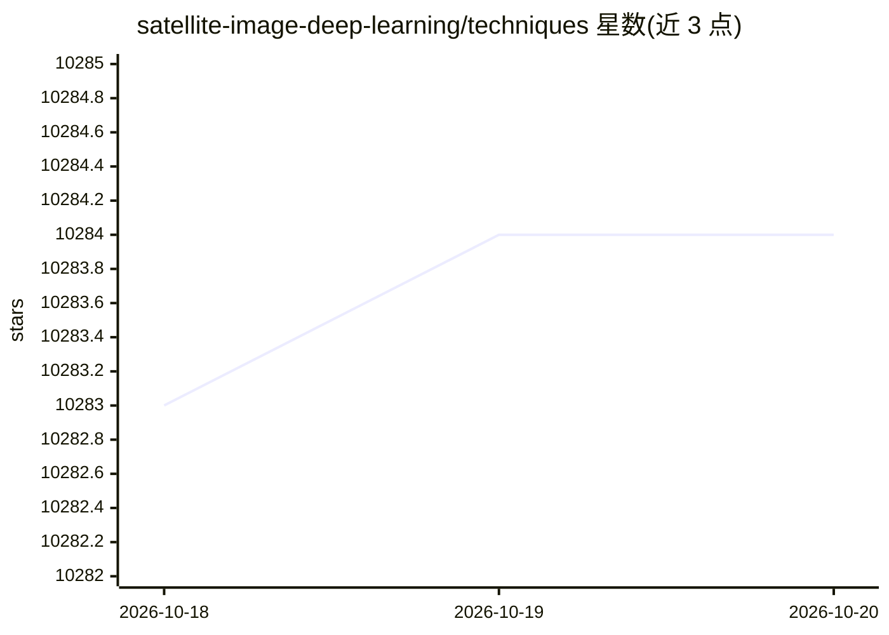

# satellite-image-deep-learning/techniques

⭐ 10,284 · Apache-2.0 · 推送 2026-10-17 · [GitHub](https://github.com/satellite-image-deep-learning/techniques) · 组织维护

**卫星与航空影像深度学习技术策展清单：按任务分类汇集方法**

由 satellite-image-deep-learning.com 维护的策展清单仓库：系统梳理面向卫星与航空影像处理的深度学习技术，覆盖分类、分割、目标检测、云检测与去除、变化检测、时间序列、作物分类、生成网络、少样本学习、SAR、基础模型与 AI agents 等约 30 个主题类别。每个类别下列出论文配套代码、数据集与教程条目，并建议用 Ctrl+F 搜索定位内容。供遥感与深度学习方向的研究者和开发者查找方法与代码。

## 筛选速览

| 维度 | 判定 | 备注 |
|---|---|---|
| AI 角色 | `ai-knowledge` | 知识聚合/清单类 |
| 许可风险 | `permissive` | Apache-2.0 |
| 部署形态 | `library` | 以包/库形式分发 |
| 模型依赖 | — | README 未给出锁定关系 |
| 硬件要求 | — | 无带数字的原话,不猜 |
| 安装摩擦 | `low` | 无编译、无系统依赖或容器化 |
| 成熟度 | — | 结构信号不足 |

## 能力要点

- 按 30 个左右任务主题组织的技术清单
- 条目多为论文配套代码、数据集与教程
- 配套网站 satellite-image-deep-learning.com

## 适用场景

- 查找卫星影像分类、分割、检测等任务的论文代码
- 了解遥感深度学习各任务的代表性方法与数据集
- 按 SAR、变化检测、基础模型等专项主题检索资源

## 场景标签

`精选清单` · 领域:学习与行业

## 证据(README 行号)

> L9: Deep learning has revolutionized the analysis and interpretation of satellite and aerial imagery, addressing unique 
> L15: - Classification
> L31: - AI agents

## 星数曲线

2026-10-18 10,283 → 2026-10-20 10,284（+1）

---
*卡片 v1 · prompt 1.4 · 生成 2026-10-20 · 置信度 mid · 依据 README sha `7d5614380bce` · [字段定义](../../DATASET.md)*
