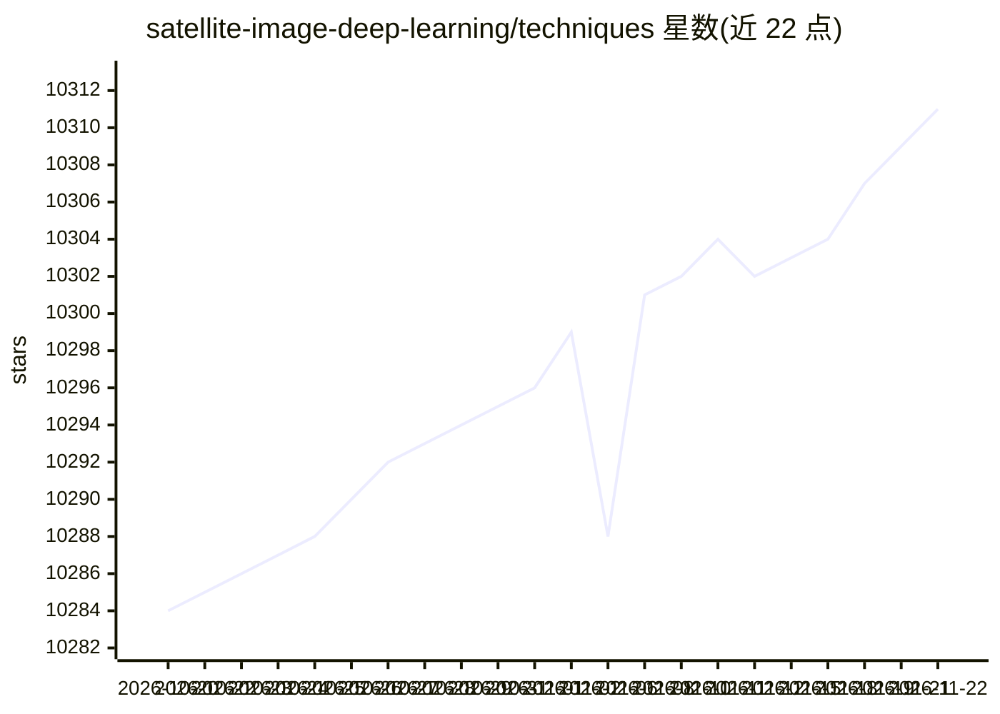

# satellite-image-deep-learning/techniques

⭐ 10,311 · Apache-2.0 · 推送 2026-11-21 · [GitHub](https://github.com/satellite-image-deep-learning/techniques) · 个人维护

**面向遥感从业者的卫星影像深度学习技术资源清单**

该仓库汇总适用于卫星与航空影像处理的深度学习技术，按分类、分割、目标检测、变化检测、云检测、时间序列、自监督学习、基础模型等约 20 个任务类别组织条目，每个条目指向具体的项目、论文或数据集链接。使用方式为在页面内搜索关键词定位相关技术；条目覆盖 PyTorch 实现的模型、基准数据集（如 EuroSAT、UC Merced）及地球观测领域的开源工具。仓库不提供统一的安装或运行入口，内容以链接编目为主。

## 筛选速览

| 维度 | 判定 | 备注 |
|---|---|---|
| AI 角色 | `ai-knowledge` | 知识聚合/清单类 |
| 许可风险 | `permissive` | Apache-2.0 |
| 部署形态 | `library` | 以包/库形式分发 |
| 模型依赖 | — | README 未给出锁定关系 |
| 硬件要求 | — | 无带数字的原话,不猜 |
| 安装摩擦 | `low` | 无编译、无系统依赖或容器化 |
| 成熟度 | — | 结构信号不足 |

## 能力要点

- 按约 20 个遥感任务类别组织技术条目
- 收录分类、分割、检测等任务的论文与开源项目链接
- 提供 EuroSAT 等多个遥感基准数据集条目

## 适用场景

- 查找某个遥感任务（如土地覆盖分类）的已有方法
- 为遥感深度学习研究寻找数据集与基准
- 检索特定技术（如 SAM、SAR）的相关项目

## 场景标签

`精选清单` `目标检测` · 领域:学习与行业

## 证据(README 行号)

> L9: Deep learning has revolutionized the analysis and interpretation of satellite and aerial imagery, addressing unique 
> L11: **How to use this repository:** use `Command + F` (Mac) or `CTRL + F` (Windows) to search this page for e.g. 'SAM'
> L13: ## Techniques

## 星数曲线

2026-10-20 10,284 → 2026-11-22 10,311（+27）

---
*卡片 v1 · prompt 1.4 · 生成 2026-11-22 · 置信度 mid · 依据 README sha `381e1d9719a2` · [字段定义](../../DATASET.md)*
