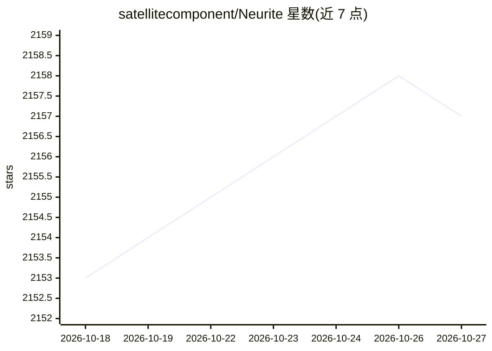

# satellitecomponent/Neurite

⭐ 2,157 · JavaScript · MIT · 推送 2026-03-16 · [GitHub](https://github.com/satellitecomponent/Neurite) · [官网](https://neurite.network/) · 组织维护

**在曼德博分形集中做思维导图并嵌入 AI agent 的知识工作区**

以分形（Mandelbrot/Julia/Burning Ship）为背景的交互式思维导图工作区：节点可承载文本、图片、视频、网页、PDF 与 AI agent，受物理模拟牵引排布。AI 部分包括 FractalGPT（把对话切分为思维图谱并锚定为长期记忆）、多 agent 聊天网络（节点间消息循环、方向控制、@引用与/命令）、本地向量库对网页/PDF 做 RAG，以及 Wolfram Alpha/Wikipedia/网络搜索插件。支持 Ollama、OpenAI、Anthropic、Groq、transformers.js 与自定义端点。思维导图与 Zettelkasten 笔记可 Markdown 双向同步。面向研究者、作者、开发者等终端用户。

## 筛选速览

| 维度 | 判定 | 备注 |
|---|---|---|
| AI 角色 | `ai-enhanced` | 去掉 AI 部分产品仍成立 |
| 许可风险 | `permissive` | MIT |
| 部署形态 | `None` |  |
| 模型依赖 | local-ok | 支持本地模型 |
| 硬件要求 | — | 无带数字的原话,不猜 |
| 安装摩擦 | `low` | 无编译、无系统依赖或容器化 |
| 成熟度 | — | 结构信号不足 |

## 能力要点

- 分形实时缩放工作区内嵌入多类型节点（文本/媒体/网页/PDF/AI）
- FractalGPT 将对话分段为思维图谱并构建长期记忆
- 多 AI 节点聊天网络：消息循环、方向控制、@引用与/命令
- 本地向量数据库对网页与 PDF 做 RAG，支持 Ollama 等本地与云端模型并行

## 适用场景

- 在无限分形画布上组织笔记、资料与网页
- 把多个 AI 模型连成对话网络协作或对比输出
- 用 Zettelkasten 双向同步维持笔记与图谱一致

## 场景标签

`Agent 记忆` `多智能体` `知识库管理` `RAG` · 领域:Agent 开发

## 证据(README 行号)

> L55:  Nodes represent text, images, videos, code, and AI agents. Together, they thread a personalized microcosm of your 
> L82:  FractalGPT
> L248:  Connected AI nodes send messages to one another. This idea contains endless possibilities. ( Hold Shift + Click t

## 星数曲线

2026-10-18 2,153 → 2026-10-27 2,157（+4）

---
*卡片 v1 · prompt 1.4 · 生成 2026-10-21 · 置信度 high · 依据 README sha `922ce7a2043e` · [字段定义](../../DATASET.md)*
