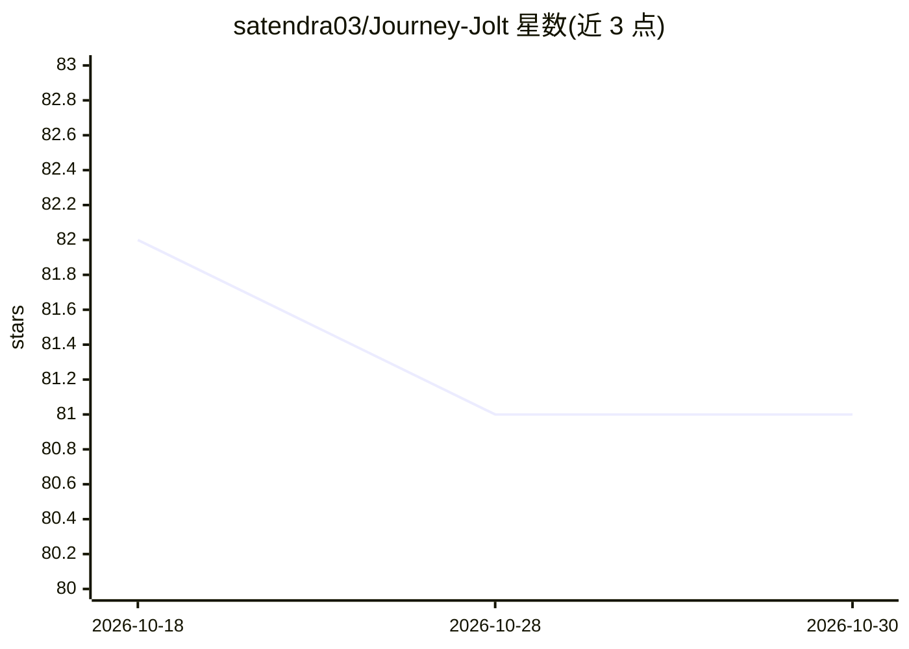

# satendra03/Journey-Jolt

⭐ 81 · JavaScript · MIT · 推送 2026-01-10 · [GitHub](https://github.com/satendra03/Journey-Jolt) · [官网](https://journeyjolt.vercel.app/) · 个人维护

**面向旅行者的 AI 行程规划 Web 应用（已暂停维护）**

基于 React + Vite 构建的旅行规划 Web 应用：用 Gemini API 分析用户偏好，生成个性化目的地、酒店与活动建议，并自动编排考虑出行时间的完整行程；集成 Google Maps 系列地理 API、Auth0 登录与 Firebase/Firestore 数据存储。本地运行需配置各服务 API key，npm install 后 npm run dev 启动。README 顶部声明项目因 Google Cloud API 产生费用而暂时停止维护。

## 筛选速览

| 维度 | 判定 | 备注 |
|---|---|---|
| AI 角色 | `ai-native` | 本体是模型或模型工具 |
| 许可风险 | `permissive` | MIT |
| 部署形态 | `library` | 以包/库形式分发 |
| 模型依赖 | — | README 未给出锁定关系 |
| 硬件要求 | — | 无带数字的原话,不猜 |
| 安装摩擦 | `low` | 无编译、无系统依赖或容器化 |
| 成熟度 | — | 结构信号不足 |

## 能力要点

- 基于 Gemini API 生成个性化目的地、酒店与活动推荐
- 自动生成考虑出行时间与偏好的完整行程
- 集成 Google Maps/Places API 与 Auth0 认证、Firebase 存储

## 适用场景

- 我想让 AI 帮我按兴趣和预算生成旅行行程
- 获取目的地酒店与活动的推荐清单
- 克隆后本地运行并二次开发

## 场景标签

 · 领域:消费级旅行应用

## 证据(README 行号)

> L37: **JourneyJolt** is an AI-based travel planning application designed to make trip planning _easier and more efficien
> L40: * **Personalized Recommendations**: The AI suggests ideal destinations, hotels, and activities tailored to the trav
> L41: * **Automated Itinerary Generation**: The app automatically creates a full itinerary that considers factors like tr

## 星数曲线

2026-10-18 82 → 2026-10-30 81（-1）

---
*卡片 v1 · prompt 1.4 · 生成 2026-10-24 · 置信度 high · 依据 README sha `0853ef001526` · [字段定义](../../DATASET.md)*
