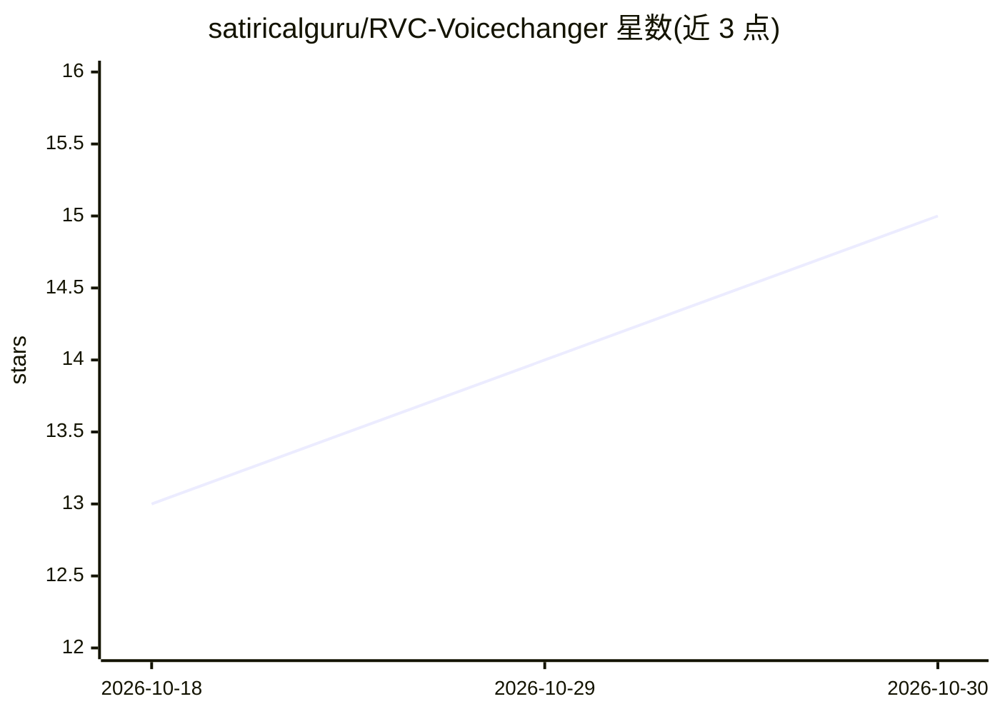

# satiricalguru/RVC-Voicechanger

⭐ 15 · TypeScript · 推送 2026-07-07 · [GitHub](https://github.com/satiricalguru/RVC-Voicechanger) · 个人维护 · 中文 README

**基于 RVC 的实时 AI 变声桌面应用，含 DSP 效果链**

面向终端用户的实时变声桌面应用：本地 RVC 管线（PyTorch、ONNX、torchfcpe 提取音高）做声音转换，内嵌 Spotify Pedalboard 实时 DSP 链（噪声门、高通滤波、压缩、变调、混响）。架构为 Electron 壳内运行 Python FastAPI 后端与 Next.js 前端。支持英/日/中三语界面、导入 Applio 语音模型、自动抓取模型配图；提供 Clean Mode 绕过 DSP 直通原始麦克风音频。需从源码安装运行，或自行打包为可执行文件。

## 筛选速览

| 维度 | 判定 | 备注 |
|---|---|---|
| AI 角色 | `ai-native` | 本体是模型或模型工具 |
| 许可风险 | `none` | — |
| 部署形态 | `desktop` | 安装包/桌面程序 |
| 模型依赖 | — | README 未给出锁定关系 |
| 硬件要求 | — | 无带数字的原话,不猜 |
| 安装摩擦 | `low` | 无编译、无系统依赖或容器化 |
| 成熟度 | — | 结构信号不足 |

## 能力要点

- 本地 RVC 管线（PyTorch/ONNX/torchfcpe）实时变声
- 内嵌 Pedalboard 实时 DSP：噪声门、滤波、压缩、变调、混响
- 拖拽导入 Applio 语音模型与模型管理器
- 英/日/中三语界面与亮暗主题

## 适用场景

- 直播或语音聊天中实时改变自己的声音
- 为不同 RVC 模型搭配 DSP 效果并保存预设
- 导入自己在 Applio 训练的语音模型使用

## 场景标签

 · 领域:音频/桌面应用

## 证据(README 行号)

> L11:  A premium, real-time AI voice changer desktop application powered by Retrieval-based Voice Conversion (RVC) and Pe
> L16: * **Real-time AI Voice Conversion:** Highly optimized local RVC pipeline utilizing PyTorch, ONNX, and torchfcpe for

## 星数曲线

2026-10-18 13 → 2026-10-30 15（+2）

---
*卡片 v1 · prompt 1.4 · 生成 2026-10-30 · 置信度 mid · 依据 README sha `e27b45232be2` · [字段定义](../../DATASET.md)*
