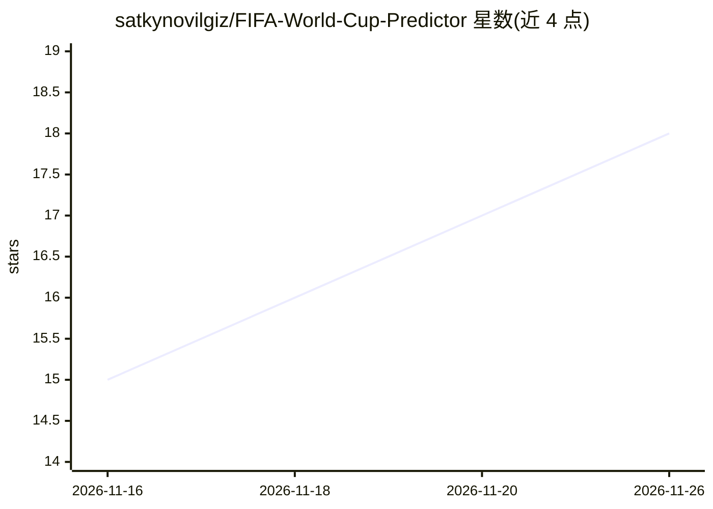

# satkynovilgiz/FIFA-World-Cup-Predictor

⭐ 18 · Jupyter Notebook · 推送 2026-11-24 · [GitHub](https://github.com/satkynovilgiz/FIFA-World-Cup-Predictor) · [官网](https://satkynovilgiz.github.io/FIFA-World-Cup-Predictor/) · 个人维护

**用机器学习与蒙特卡洛模拟预测世界杯赛果的开源项目**

基于 EA Sports FIFA 评分、Elo 评分与 FIFA 排名，用从五个模型中选出的 XGBoost 预测单场比赛概率，再通过蒙特卡洛模拟（报告的 2026 年运行使用 1,000,000 次模拟）估计各队晋级与夺冠概率，覆盖 48 队赛制的小组赛、最佳第三名晋级与 32 强淘汰赛。采用留一届世界杯交叉验证评估，报告中 5 届冠军猜中 3 届，平均 log loss 1.961。以 Python 脚本形式提供复现命令，声明仅用于研究与教育。

## 筛选速览

| 维度 | 判定 | 备注 |
|---|---|---|
| AI 角色 | `ai-native` | 本体是模型或模型工具 |
| 许可风险 | `none` | — |
| 部署形态 | `None` |  |
| 模型依赖 | — | README 未给出锁定关系 |
| 硬件要求 | — | 无带数字的原话,不猜 |
| 安装摩擦 | `low` | 无编译、无系统依赖或容器化 |
| 成熟度 | — | 结构信号不足 |

## 能力要点

- XGBoost 从 Logistic Regression/Random Forest/LightGBM/CatBoost 五个测试模型中选出
- 留一届世界杯交叉验证：5 届中 3 届猜中冠军，平均 log loss 1.961
- 48 队赛制的完整锦标赛蒙特卡洛模拟（报告使用 1,000,000 次）
- 脚本可导出夺冠到 32 强各阶段的 CSV 概率

## 适用场景

- 复现 2026 年世界杯夺冠概率预测
- 研究机器学习结合蒙特卡洛的赛果预测方法
- 调整模拟次数与随机种子生成自己的预测结果

## 场景标签

 · 领域:体育预测/数据科学

## 证据(README 行号)

> L5: Match probabilities, XGBoost, and Monte Carlo simulations — from historical World Cups to a 48-team tournament.
> L15: Predict each match using **EA Sports FIFA ratings, Elo ratings, and FIFA rankings**. Then simulate the entire tourn

## 星数曲线

2026-11-16 15 → 2026-11-26 18（+3）

---
*卡片 v1 · prompt 1.4 · 生成 2026-11-18 · 置信度 high · 依据 README sha `d584bd1d5b74` · [字段定义](../../DATASET.md)*
