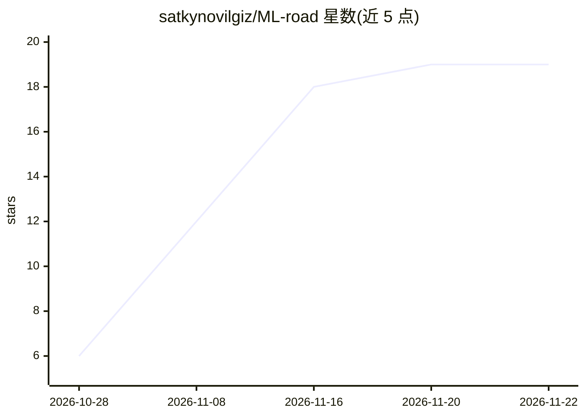

# satkynovilgiz/ML-road

⭐ 19 · Python · MIT · 推送 2026-09-28 · [GitHub](https://github.com/satkynovilgiz/ML-road) · [官网](https://satkynovilgiz.github.io/ML-road/) · 个人维护

**机器学习到 AI agent 的学习路线图：资源与项目创意**

一个学习路径仓库：以 6 个阶段（Python/数学基础、机器学习、深度学习、LLM 工程、Agent、生产部署）组织学习内容与配套小项目，每阶段列出学习主题和构建练习。附带资源表（Google ML Crash Course、CS231n、CS224N、Hugging Face LLM Course、MCP 文档等）及进阶论文（ReAct、Toolformer）。仓库内含 MNIST 手写数字识别、汉字识别等代码示例；其余项目条目为未完成的练习创意，README 未给出安装运行命令。

## 筛选速览

| 维度 | 判定 | 备注 |
|---|---|---|
| AI 角色 | `ai-knowledge` | 知识聚合/清单类 |
| 许可风险 | `permissive` | MIT |
| 部署形态 | `None` |  |
| 模型依赖 | — | README 未给出锁定关系 |
| 硬件要求 | — | 无带数字的原话,不猜 |
| 安装摩擦 | `low` | 无编译、无系统依赖或容器化 |
| 成熟度 | — | 结构信号不足 |

## 能力要点

- 6 阶段学习路径：基础→ML→DL→LLM→Agent→生产
- 每阶段配学习主题与小项目练习
- 分领域起步资源表与进阶论文（ReAct、Toolformer）
- 仓库含 MNIST 与汉字识别代码示例

## 适用场景

- 按阶段自学从机器学习到 AI agent 的完整路径
- 为每个学习阶段寻找配套的小项目练习
- 查找各领域（ML/CV/NLP/LLM/MCP）的入门课程资源

## 场景标签

`教程课程` · 领域:学习与行业

## 证据(README 行号)

> L5: A practical learning path through **machine learning, deep learning, LLMs, and AI agents** — with resources to study
> L17: |Stage|Learn|Build|

## 星数曲线

2026-10-28 6 → 2026-11-22 19（+13）

---
*卡片 v1 · prompt 1.4 · 生成 2026-11-18 · 置信度 high · 依据 README sha `1ffae4f76dce` · [字段定义](../../DATASET.md)*
