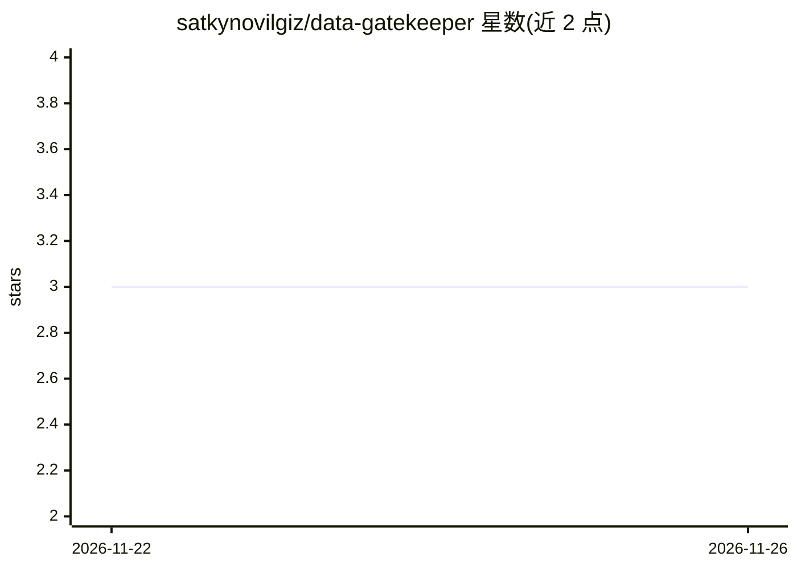

# satkynovilgiz/data-gatekeeper

⭐ 3 · Python · MIT · 推送 2026-11-25 · [GitHub](https://github.com/satkynovilgiz/data-gatekeeper) · 个人维护

**数据集画像、清洗与质量评分的自动化流水线后端**

面向训练/使用前的数据集处理引擎，按四个模块组织：画像（缺失值与伪装缺失检测、PII、格式问题、0–100 质量评分与清洗建议）、清洗（模式推断、KNN/回归/迭代插补、IQR 与 Isolation Forest 离群值、模糊重复检测、清洗日志）、校验与自动化集成。提供 CLI、FastAPI 画像接口（uvicorn 启动）与 JSON Schema 报告格式，原始文件不被修改。模块 1 已完成，模块 2 进行中，模块 3/4 未开始；来自实习培训项目，按冲刺开发。

## 筛选速览

| 维度 | 判定 | 备注 |
|---|---|---|
| AI 角色 | `ai-enhanced` | 去掉 AI 部分产品仍成立 |
| 许可风险 | `permissive` | MIT |
| 部署形态 | `library` | 以包/库形式分发 |
| 模型依赖 | — | README 未给出锁定关系 |
| 硬件要求 | — | 无带数字的原话,不猜 |
| 安装摩擦 | `medium` | 含编译或系统依赖之一 |
| 成熟度 | `idea` | |

## 能力要点

- 伪装缺失值检测（如 unknown、pdays=999）并给出清洗建议
- 多种插补方法（median/knn/regression/iterative）及隐藏值回填式评估
- IQR 与 Isolation Forest 离群值标记、模糊重复检测
- 清洗前后质量评分对比与逐变更的 cleaning_log.json

## 适用场景

- 建模前检查并清洗带伪装缺失的原始数据集
- 为数据列生成 schema.json 与质量报告
- 对比不同插补方法在自己数据上的误差与耗时

## 场景标签

 · 领域:数据工程/数据质量

## 证据(README 行号)

> L7: A backend engine that **profiles, cleans, and validates** any dataset before it is used.
> L19: |2. Cleaning & Transformation|🔄 **in progress**: Sprint 4 ✅ core pipeline (schema inference, cleaning steps, cleani

## 星数曲线

2026-11-22 3 → 2026-11-26 3（+0）

---
*卡片 v1 · prompt 1.4 · 生成 2026-11-22 · 置信度 mid · 依据 README sha `18a956436a26` · [字段定义](../../DATASET.md)*
