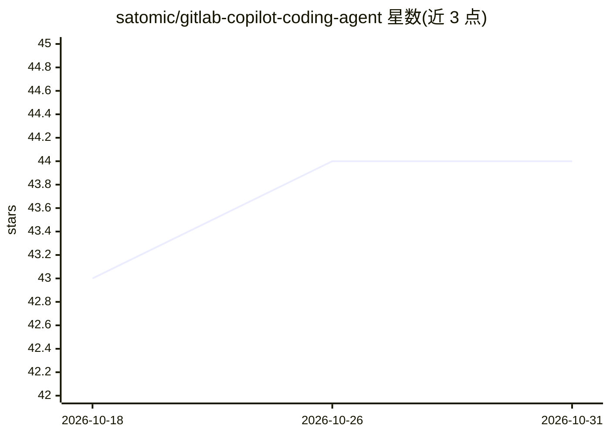

# satomic/gitlab-copilot-coding-agent

⭐ 44 · Shell · 推送 2025-12-11 · [GitHub](https://github.com/satomic/gitlab-copilot-coding-agent) · 个人维护 · 中文 README

**把 GitHub Copilot CLI 接入 GitLab CI/CD 的全自动编码代理**

由 Flask Webhook 服务与 GitLab CI/CD 流水线组成的编码自动化系统，底层调用 GitHub Copilot CLI。支持三种工作流：把 Issue 指派给 Copilot 机器人后自动生成 TODO 计划、创建 MR 并实现代码；在 MR 中 @copilot-agent 评论实现快速修改；将 Copilot 指派为 MR 审阅者以产出按严重度分类的代码审查报告。需要 GitLab 账号、带 Docker/Kubernetes 执行器的 Runner、GitHub Copilot 订阅与相应 Personal Access Token；Webhook 服务以 Docker 镜像或 Python 源码方式部署。

## 筛选速览

| 维度 | 判定 | 备注 |
|---|---|---|
| AI 角色 | `ai-native` | 本体是模型或模型工具 |
| 许可风险 | `none` | — |
| 部署形态 | `self-host` | docker 或自建部署 |
| 模型依赖 | — | README 未给出锁定关系 |
| 硬件要求 | — | 无带数字的原话,不猜 |
| 安装摩擦 | `low` | 无编译、无系统依赖或容器化 |
| 成熟度 | — | 结构信号不足 |

## 能力要点

- Issue 指派→自动生成 TODO 计划→创建 MR→实现代码的全自动工作流
- MR 评论 @copilot-agent 触发快速修改并推送至源分支
- MR 审阅者工作流产出按严重度分类的审查报告（含 APPROVE/REQUEST_CHANGES 建议）
- 提供预装并预配置认证的 Docker 镜像 satomic/copilot-cli:latest

## 适用场景

- 团队在 GitLab 上把 Issue 指派给机器人实现自动编码
- 通过 MR 评论让代理补充功能、修 bug 或重构
- 指派 Copilot 为审阅者获得代码审查报告

## 场景标签

`编码 Agent` `代码审查` · 领域:编码与开发

## 证据(README 行号)

> L5: A fully automated coding agent powered by GitHub Copilot CLI and GitLab CI/CD. This system enables autonomous code i
> L43: Issue assigned to Copilot → Webhook → Trigger Pipeline →
> L44: Acknowledge Issue → Generate TODO Plan → Create MR →
> L45: Implement Code → Push Changes → Update MR & Issue

## 星数曲线

2026-10-18 43 → 2026-10-31 44（+1）

---
*卡片 v1 · prompt 1.4 · 生成 2026-10-25 · 置信度 high · 依据 README sha `14aedcbe27b7` · [字段定义](../../DATASET.md)*
