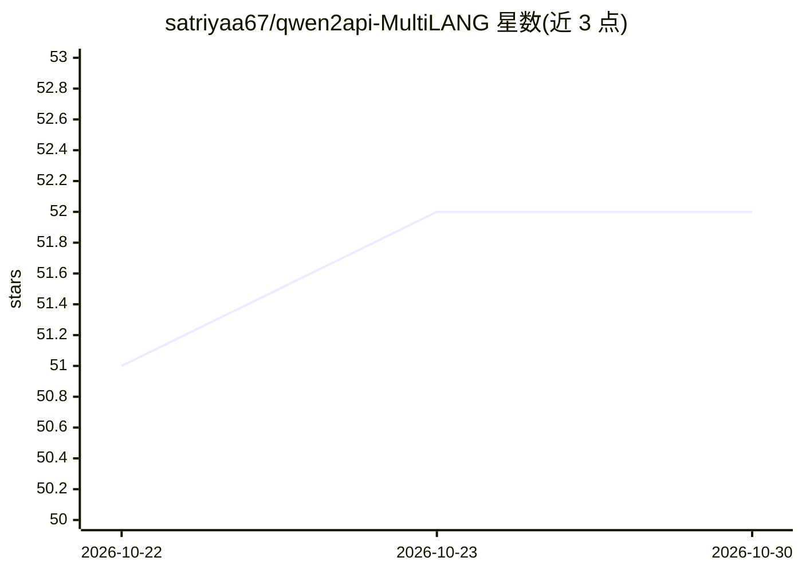

# satriyaa67/qwen2api-MultiLANG

⭐ 52 · Go · 推送 2026-10-19 · [GitHub](https://github.com/satriyaa67/qwen2api-MultiLANG) · [官网](https://github.com/YuJunZhiXue/qwen2API) · 个人维护 · 中文 README

**qwen2API 的多语言 fork：自托管 Qwen Web 转 OpenAI 兼容 API 网关**

YuJunZhiXue/qwen2API 的 fork，唯一改动是为管理 WebUI 增加英语与土耳其语界面，代码全部来自原项目。本体将 Qwen Web 能力转换为 OpenAI、Anthropic、Gemini 兼容的 API 协议，提供 WebUI 管理账号池、下游 API key、运行时配置与对话/图像/视频测试；v2.0 采用 Go 后端 + React 前端，v1.0 为已弃用方向的 Python 实现。通过 Docker Hub 镜像部署，GPL-3.0 许可。

## 筛选速览

| 维度 | 判定 | 备注 |
|---|---|---|
| AI 角色 | `ai-ecosystem` | LLM/agent 周边工具 |
| 许可风险 | `none` | — |
| 部署形态 | `desktop` | 安装包/桌面程序 |
| 模型依赖 | — | README 未给出锁定关系 |
| 硬件要求 | — | 无带数字的原话,不猜 |
| 安装摩擦 | `low` | 无编译、无系统依赖或容器化 |
| 成熟度 | — | 结构信号不足 |

## 能力要点

- OpenAI/Anthropic/Gemini 三类兼容 API 端点
- 多账号池轮换与按账号并发、冷却追踪
- WebUI 支持账号、API key、运行时配置与模型测试
- 在原中文基础上新增英语与土耳其语界面

## 适用场景

- 把 Qwen Web 账号封装成 OpenAI 兼容 API 供下游应用调用
- 自托管网关并统一管理多账号与下游密钥
- 用非中文界面管理网关

## 场景标签

`模型网关` · 领域:Agent 开发

## 证据(README 行号)

> L25:  Self-hosted Qwen Web protocol gateway with OpenAI, Anthropic, and Gemini compatible APIs.
> L47: qwen2API converts Qwen Web capabilities into common API protocols and provides a local WebUI for account management
> L56: |OpenAI-compatible APIs|`/v1/chat/completions`, `/v1/responses`, `/v1/models`, `/v1/files`, `/v1/images/generations

## 星数曲线

2026-10-22 51 → 2026-10-30 52（+1）

---
*卡片 v1 · prompt 1.4 · 生成 2026-10-24 · 置信度 high · 依据 README sha `699c4251cd37` · [字段定义](../../DATASET.md)*
