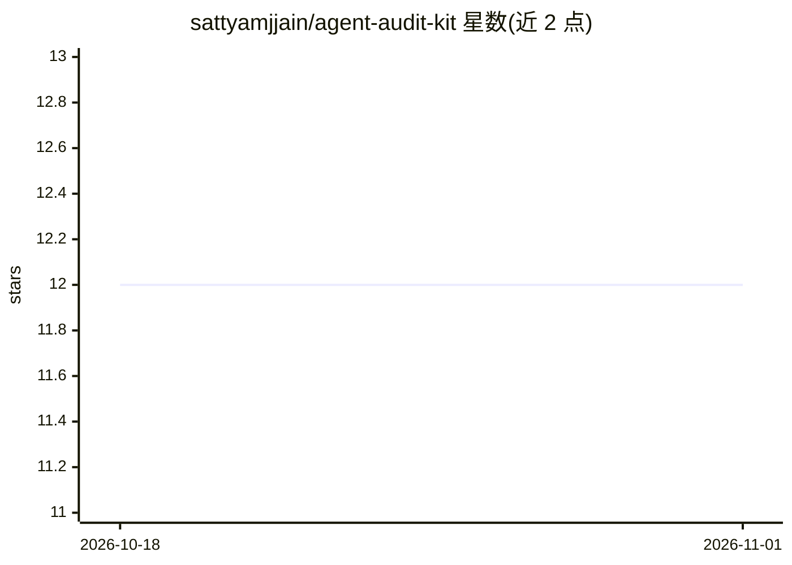

# sattyamjjain/agent-audit-kit

⭐ 12 · Python · Apache-2.0 · 推送 2026-10-31 · [GitHub](https://github.com/sattyamjjain/agent-audit-kit) · [官网](https://github.com/sattyamjjain/agent-audit-kit#readme) · 个人维护

**MCP 连接的 AI agent 管道静态安全扫描器**

面向接入 MCP 的 AI agent 流水线的静态安全扫描工具，含 438 条规则、14 个安全类别，覆盖 OWASP Agentic Top 10 与 MCP Top 10。检测 MCP 配置缺失认证、硬编码密钥、工具投毒、rug pull、污染数据流等问题，支持 11 个 agent 平台。完全离线运行，无模型参与，输出 SARIF、PDF 合规证据包（映射 14 个框架）、SBOM 与 OpenVEX。提供 pip 安装、CLI、pre-commit 钩子与 GitHub Action；机械修复配方仅覆盖 11 条规则，其余保持建议性。

## 筛选速览

| 维度 | 判定 | 备注 |
|---|---|---|
| AI 角色 | `ai-ecosystem` | LLM/agent 周边工具 |
| 许可风险 | `permissive` | Apache-2.0 |
| 部署形态 | `self-host` | docker 或自建部署 |
| 模型依赖 | — | README 未给出锁定关系 |
| 硬件要求 | — | 无带数字的原话,不猜 |
| 安装摩擦 | `low` | 无编译、无系统依赖或容器化 |
| 成熟度 | — | 结构信号不足 |

## 能力要点

- 438 条规则 / 14 类检测，覆盖 OWASP Agentic 与 MCP Top 10
- 完全离线与确定性输出（20/20 次运行零差异），无 LLM 参与
- SARIF + PDF 证据包映射 14 个合规框架，含 CycloneDX/SPDX SBOM 与 OpenVEX
- pin/verify 指纹核验工具面，GitHub Action 与 pre-commit 钩子

## 适用场景

- 在 CI 中扫描 MCP 配置与 agent 项目的安全隐患
- 为审计生成映射 EU AI Act 等框架的合规证据包
- 用 SARIF 输出接入 GitHub Security tab 呈现发现

## 场景标签

`网络安全` · 领域:学习与行业

## 证据(README 行号)

> L15: Static security scanner for MCP-connected AI agent pipelines. It finds
> L17: violations and tainted data flows across **11 agent platforms** — and emits the

## 星数曲线

2026-10-18 12 → 2026-11-01 12（+0）

---
*卡片 v1 · prompt 1.4 · 生成 2026-11-01 · 置信度 mid · 依据 README sha `29e7cb5997a3` · [字段定义](../../DATASET.md)*
