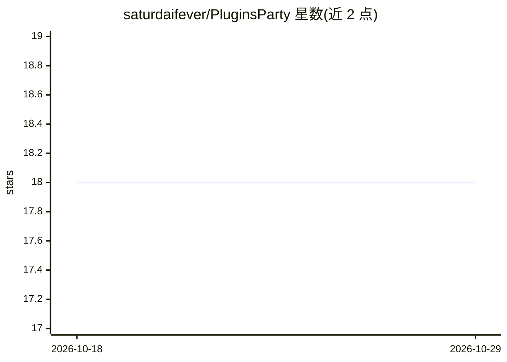

# saturdaifever/PluginsParty

⭐ 18 · Python · Apache-2.0 · 推送 2026-07-19 · [GitHub](https://github.com/saturdaifever/PluginsParty) · 个人维护

**让各类 LLM 调用 ChatGPT 插件的命令行客户端（已归档弃用）**

让 ChatGPT 插件在非 OpenAI 模型上使用的 Python 命令行客户端：读取插件的 ai-plugin.json 清单与 OpenAPI 规范，向模型注入插件使用指令，模型在对话中按需调用插件；支持 Vicuna、StableVicuna、GPT-3.5、GPT-4 API（均经 OpenAI 客户端 API 访问），提供流式输出、代码块执行、Bearer 认证、对话中 /register 注册插件等内部命令。README 首行声明项目已三年未更新、完全弃用，仅作存档保留。克隆仓库并 pip 安装依赖后运行，需设置 OPENAI_API_KEY。

## 筛选速览

| 维度 | 判定 | 备注 |
|---|---|---|
| AI 角色 | `ai-ecosystem` | LLM/agent 周边工具 |
| 许可风险 | `permissive` | Apache-2.0 |
| 部署形态 | `library` | 以包/库形式分发 |
| 模型依赖 | — | README 未给出锁定关系 |
| 硬件要求 | — | 无带数字的原话,不猜 |
| 安装摩擦 | `low` | 无编译、无系统依赖或容器化 |
| 成熟度 | — | 结构信号不足 |

## 能力要点

- 为 Vicuna/StableVicuna/GPT-3.5/GPT-4 提供 ChatGPT 插件开箱支持
- 对话中 /register 注册插件并自动拉取清单与 OpenAPI 规范
- 支持流式输出、助手代码块执行与 Bearer 认证
- README 首行声明项目已完全弃用，仅作存档

## 适用场景

- 在非 OpenAI 的本地模型上试用 ChatGPT 生态插件
- 作为多 LLM 插件试验场进行插件测试
- 命令行对话中让模型调用天气、网页搜索等已验证插件

## 场景标签

`聊天机器人` · 领域:对话与助手

## 证据(README 行号)

> L15: This project aims to provide **out-of-the-box support for ChatGPT plugins to other conversational LLMs**. It has be
> L19: The client is built to allow LLMs to invoke external plugins, extending LLM capabilities beyond language generation

## 星数曲线

2026-10-18 18 → 2026-10-29 18（+0）

---
*卡片 v1 · prompt 1.4 · 生成 2026-10-29 · 置信度 mid · 依据 README sha `4107716a7d58` · [字段定义](../../DATASET.md)*
