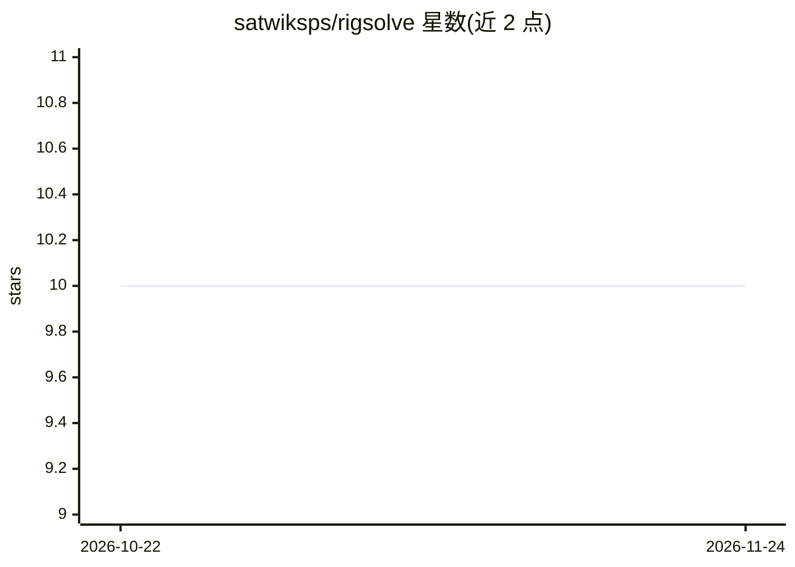

# satwiksps/rigsolve

⭐ — · [GitHub]() · 个人维护

**为 PyTorch 开发者解析 torch/CUDA/GPU 扩展兼容性并生成安装方案**

rigsolve 是离线优先的兼容性解析 CLI 工具：在不导入 torch 的前提下探测机器的 NVIDIA 驱动、CUDA 运行时、Python ABI、平台等维度，基于带来源与证据分级的版本化兼容矩阵，确定性地求解并输出可审查的安装或修复计划（pip 命令、TOML lockfile、Dockerfile、JSON 等格式）。矩阵当前含 114 条带来源事实。当前范围限定 Linux x86_64 与 NVIDIA CUDA GPU；解析默认不安装包，安装需显式 --execute。

## 筛选速览

| 维度 | 判定 | 备注 |
|---|---|---|
| AI 角色 | `ai-ecosystem` | LLM/agent 周边工具 |
| 许可风险 | `permissive` | — |
| 部署形态 | `self-host` | docker 或自建部署 |
| 模型依赖 | — | README 未给出锁定关系 |
| 硬件要求 | — | 无带数字的原话,不猜 |
| 安装摩擦 | `low` | 无编译、无系统依赖或容器化 |
| 成熟度 | — | 结构信号不足 |

## 能力要点

- 不导入 torch 即可探测机器环境（detect/doctor 命令）
- 带来源与证据分级的版本化兼容矩阵（114 条事实）
- 同一方案可输出为 pip 命令、TOML lockfile、Dockerfile、JSON 等
- 默认离线运行，安装需显式 opt-in --execute

## 适用场景

- 为新 GPU 机器求解兼容的 torch/CUDA/扩展版本组合
- 诊断已安装环境中已知的兼容性冲突并生成最小修复计划
- 生成可复现的依赖 lockfile 或 Dockerfile 用于部署

## 场景标签

 · 领域:MLOps/开发工具链

## 证据(README 行号)

> L3:  rigsolve turns a GPU target into a compatible torch, CUDA, and extension plan.
> L5:  rigsolve is an offline-first compatibility resolver for PyTorch, CUDA, and native GPU extensions.
> L157: rigsolve 1.0 has a deliberately narrow support scope: Linux x86_64, NVIDIA CUDA, PyTorch, and selected native exte

## 星数曲线

2026-10-22 10 → 2026-11-24 10（+0）

---
*卡片 v1 · prompt 1.4 · 生成 2026-11-19 · 置信度 mid · 依据 README sha `5ab4c0093543` · [字段定义](../../DATASET.md)*
