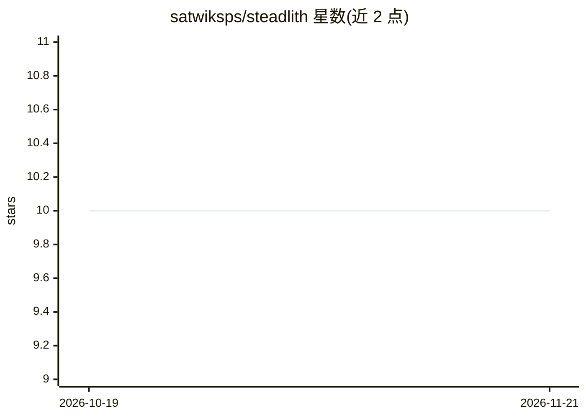

# satwiksps/steadlith

⭐ 10 · Python · Apache-2.0 · 推送 2026-11-01 · [GitHub](https://github.com/satwiksps/steadlith) · [官网](https://steadlith.vercel.app) · 个人维护

**为单机 RAG 索引提供增量更新与嵌入缓存复用的 Python 库/CLI**

面向维护单主机 RAG 索引、文档或源码频繁编辑的工程师：用 Rabin 内容定义分块使未变文本的块边界保持稳定，通过 manifest diff 将块分类为 add/keep/move/delete，未变块复用内容寻址的 SQLite 嵌入缓存，支持 dry-run 计划、事务化索引、墓碑删除、回滚与恢复。定位为库和规划器而非 RAG 框架，集成点在编排库之下、嵌入/向量提供方之上。需 Python 3.10+，默认离线词法检索，语义匹配需切换 OpenAI 或 sentence-transformers 提供方。

## 筛选速览

| 维度 | 判定 | 备注 |
|---|---|---|
| AI 角色 | `ai-ecosystem` | LLM/agent 周边工具 |
| 许可风险 | `permissive` | Apache-2.0 |
| 部署形态 | `library` | 以包/库形式分发 |
| 模型依赖 | — | README 未给出锁定关系 |
| 硬件要求 | — | 无带数字的原话,不猜 |
| 安装摩擦 | `low` | 无编译、无系统依赖或容器化 |
| 成熟度 | — | 结构信号不足 |

## 能力要点

- Rabin 内容定义分块（cdc-rabin）使编辑点远处的块边界保持稳定
- 内容寻址 SQLite 嵌入缓存，未变块跳过重嵌入
- dry-run 计划、事务化应用、墓碑删除、迁移恢复与回滚
- 内置五个语料库、45 个确定性编辑用例的回归基准

## 适用场景

- 文档频繁小改时降低 RAG 索引的重嵌入开销
- 为本地 RAG 管道提供可预览、可回滚的增量索引
- 需要确定性、可复现分块与嵌入身份的场景

## 场景标签

`RAG` `文档解析` · 领域:知识与检索

## 证据(README 行号)

> L26: Steadlith is for the engineer responsible for a single-host RAG index over frequently edited documentation or sourc
> L49: Steadlith is deliberately a library and planner, not a RAG framework. The intended integration point is below orche
> L30: The v1 chunk-identity schema is compatibility-stable and protected by golden-vector tests. Built-in five-corpus ben

## 星数曲线

2026-10-19 10 → 2026-11-21 10（+0）

---
*卡片 v1 · prompt 1.4 · 生成 2026-11-19 · 置信度 high · 依据 README sha `bb4f666b105b` · [字段定义](../../DATASET.md)*
