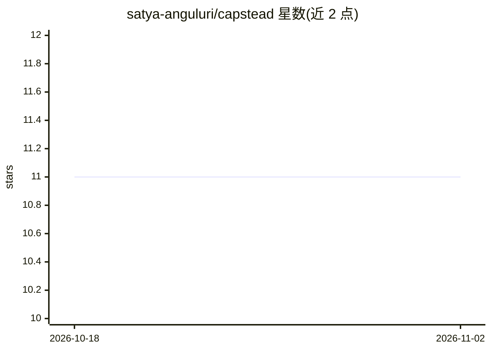

# satya-anguluri/capstead

⭐ 11 · Java · Apache-2.0 · 推送 2026-10-01 · [GitHub](https://github.com/satya-anguluri/capstead) · [官网](https://engineerprep.io/capstead/) · 个人维护

**Spring Boot AI 能力治理层：一个注解获得注册、计费与观测**

面向 Spring Boot 应用的 AI 能力治理与观测平台，定位为框架之外的外围层。通过 Spring AOP 将普通方法包装为受治理的 CapabilityExecution，提供能力注册表与版本管理、按能力归因的 token 成本追踪与每日预算（超限抛异常阻断）、JDBC 持久化执行历史与父子执行树、Micrometer 指标端点及仪表盘。支持注解、YAML 配置、声明式接口三种声明方式，可将能力导出为带治理信息的 MCP 工具。模型调用可复用 Spring AI、LangChain4j 或自实现 CapabilityModelInvoker 接口；自身不测量 token，而是归因 Spring AI 的已有数据。

## 筛选速览

| 维度 | 判定 | 备注 |
|---|---|---|
| AI 角色 | `ai-ecosystem` | LLM/agent 周边工具 |
| 许可风险 | `permissive` | Apache-2.0 |
| 部署形态 | `None` |  |
| 模型依赖 | — | README 未给出锁定关系 |
| 硬件要求 | — | 无带数字的原话,不猜 |
| 安装摩擦 | `low` | 无编译、无系统依赖或容器化 |
| 成熟度 | — | 结构信号不足 |

## 能力要点

- 单注解即可将方法注册为可发现、带版本与所有者的能力
- 按能力归因的 per-model 成本追踪与 @DailyBudget 预算强制
- JDBC 持久化执行历史（PostgreSQL/H2），支持跨实例聚合与执行树
- 可将受治理能力导出为 MCP 工具（tools/list 与 tools/call 端点）

## 适用场景

- 多个团队和服务想知道有哪些 AI 能力、谁负责、花了多少钱
- 给线上 AI 能力设置每日成本预算并在超限时阻断调用
- 把现有 Spring 方法不改代码地升级为受治理、可导出 MCP 的能力

## 场景标签

`LLM 可观测性` · 领域:评测与运维

## 证据(README 行号)

> L5: Capstead is **not** another AI framework. It's the governance layer that sits *around* your AI (Spring AI, LangChain
> L15: Modern apps expose AI capabilities across many services and teams, and nobody can answer: *what capabilities exist,

## 星数曲线

2026-10-18 11 → 2026-11-02 11（+0）

---
*卡片 v1 · prompt 1.4 · 生成 2026-11-01 · 置信度 high · 依据 README sha `f4091d737b07` · [字段定义](../../DATASET.md)*
