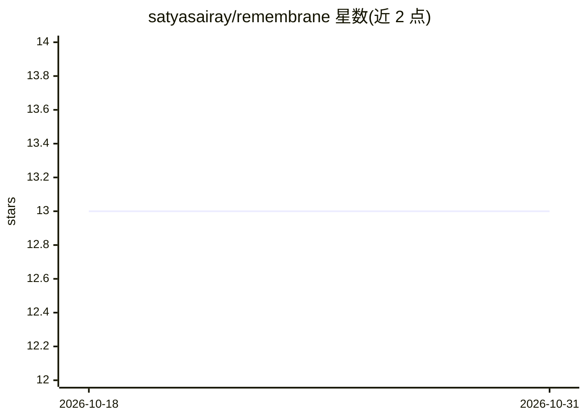

# satyasairay/remembrane

⭐ 13 · Python · MIT · 推送 2026-06-12 · [GitHub](https://github.com/satyasairay/remembrane) · [官网](https://pypi.org/project/remembrane/) · 个人维护

**本地优先的 AI agent 记忆库：单 SQLite 文件、零必装依赖**

为 AI agent 提供持久化记忆的 Python 库：以单个 SQLite 文件存储记忆，默认嵌入器为纯标准库实现，无必装依赖。支持混合检索（向量+BM25 精确评分）、可解释排序、时间旅行日志、冲突检测（启发式、确定性）、基于任务结果的重要性学习、token 预算装箱与确定性测试工具；提供 LangChain/CrewAI 适配器、CLI 与内置 MCP 服务器，可接入 Claude 等支持 MCP 的 agent。设计上限约 5 万条记忆，超出属向量数据库范畴。

## 筛选速览

| 维度 | 判定 | 备注 |
|---|---|---|
| AI 角色 | `ai-ecosystem` | LLM/agent 周边工具 |
| 许可风险 | `permissive` | MIT |
| 部署形态 | `library` | 以包/库形式分发 |
| 模型依赖 | — | README 未给出锁定关系 |
| 硬件要求 | — | 无带数字的原话,不猜 |
| 安装摩擦 | `low` | 无编译、无系统依赖或容器化 |
| 成熟度 | — | 结构信号不足 |

## 能力要点

- 单 SQLite 文件存储全部记忆，零必装依赖
- 向量+BM25 混合精确检索，每次结果附完整排序分解
- 冲突感知检索：确定性启发式检测矛盾并交由 agent 裁决
- 每次变更均入日志，支持快照、diff 与任意时点重建

## 适用场景

- 为我的 agent 添加跨会话持久记忆
- 通过 MCP 给 Claude Desktop/Code 等客户端接入记忆
- 在 CI 中对 agent 记忆行为做单元测试
- 审计 agent 在历史时点相信什么及记忆如何演变

## 场景标签

`Agent 记忆` · 领域:Agent 开发

## 证据(README 行号)

> L3: **Local-first persistent memory for AI agents.** One SQLite file, zero required dependencies. Exact hybrid recall (v
> L19: - **Framework-agnostic.** Use it bare, through the LangChain or CrewAI adapters, or expose it to any MCP-capable ag
> L93: Give any MCP-capable agent (e.g. Claude Desktop, Claude Code) persistent memory:

## 星数曲线

2026-10-18 13 → 2026-10-31 13（+0）

---
*卡片 v1 · prompt 1.4 · 生成 2026-10-31 · 置信度 high · 依据 README sha `c6791cfa54a2` · [字段定义](../../DATASET.md)*
