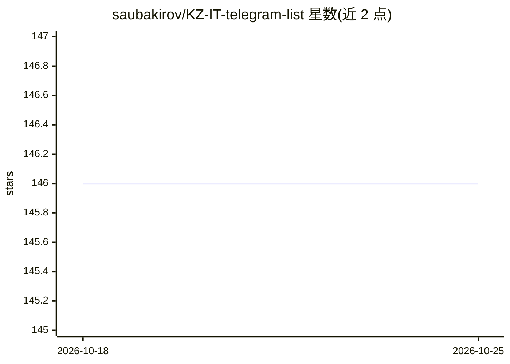

# saubakirov/KZ-IT-telegram-list

⭐ 146 · Python · NOASSERTION · 推送 2026-08-29 · [GitHub](https://github.com/saubakirov/KZ-IT-telegram-list) · [官网](https://saubakirov.github.io/KZ-IT-telegram-list/) · 个人维护

**哈萨克斯坦 IT 与创业 Telegram 社区名录（42群·36频道·4机器人）**

面向哈萨克斯坦技术社区与移民/求职者的 Telegram 群组、频道和机器人策展清单：收录 42 个群、36 个频道、4 个机器人，按 19 个类别组织（AI、编程语言、DevOps、安全、招聘、创业、活动等），条目含句柄、成员数与核验日期，并提供含死亡原因的归档区。覆盖英、俄、哈萨克三语社区，含 2 个已消亡社区记录。纯目录内容，无可安装软件。

## 筛选速览

| 维度 | 判定 | 备注 |
|---|---|---|
| AI 角色 | `ai-knowledge` | 知识聚合/清单类 |
| 许可风险 | `none` | NOASSERTION |
| 部署形态 | `None` |  |
| 模型依赖 | — | README 未给出锁定关系 |
| 硬件要求 | — | 无带数字的原话,不猜 |
| 安装摩擦 | `low` | 无编译、无系统依赖或容器化 |
| 成熟度 | — | 结构信号不足 |

## 能力要点

- 82 个活跃社区按 19 个类别组织，逐条标注成员数与核验日期
- 含 AI、ML 招聘、数据科学等 AI 相关社区条目
- 归档区记录 2 个已消亡社区及原因
- 三语（EN/RU/KK）社区覆盖

## 适用场景

- 到哈萨克斯坦工作或移民前查找本地 IT 社群与求职频道
- 按技术方向（DevOps、安全、数据等）加入对应 Telegram 社区
- 了解哈萨克斯坦创业生态相关频道与活动信息

## 场景标签

`精选清单` · 领域:学习与行业

## 证据(README 行号)

> L3: > A curated list of IT-related Telegram groups, channels, and bots for the Kazakhstan tech community.
> L5: **42** groups · **36** channels · **4** bots · **19** categories · verified **2026-08-27**

## 星数曲线

2026-10-18 146 → 2026-10-25 146（+0）

---
*卡片 v1 · prompt 1.4 · 生成 2026-10-22 · 置信度 high · 依据 README sha `1757eee33741` · [字段定义](../../DATASET.md)*
