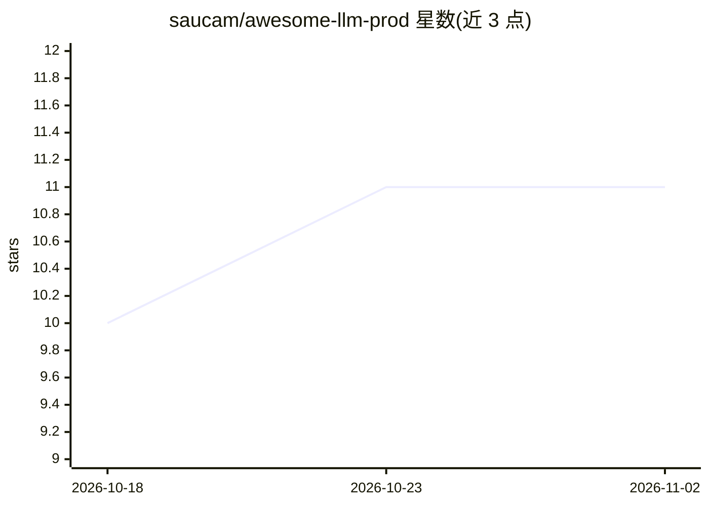

# saucam/awesome-llm-prod

⭐ 11 · Python · CC0-1.0 · 推送 2026-07-11 · [GitHub](https://github.com/saucam/awesome-llm-prod) · 个人维护

**生产级开源 LLM 项目策展清单，按用途分类编目**

一个 awesome 类策展仓库：收录生产就绪的开源 LLM 项目，按训练/微调、推理与部署、评测与可观测、Agent 编排、实际应用、向量数据库与嵌入六个板块组织表格，每条列出项目名、支持方、标签与描述，并附目录导航。面向需要在真实场景中选型 LLM 工具链的开发者与团队。仓库本身为 Markdown 清单，不提供安装或运行方式，内容为链接与简介聚合。

## 筛选速览

| 维度 | 判定 | 备注 |
|---|---|---|
| AI 角色 | `ai-knowledge` | 知识聚合/清单类 |
| 许可风险 | `viral` | CC0-1.0 |
| 部署形态 | `None` |  |
| 模型依赖 | — | README 未给出锁定关系 |
| 硬件要求 | — | 无带数字的原话,不猜 |
| 安装摩擦 | `low` | 无编译、无系统依赖或容器化 |
| 成熟度 | — | 结构信号不足 |

## 能力要点

- 覆盖训练/微调、推理部署、评测监控等六大类目
- 每条目含支持方、标签与一句话描述
- 收录范围限定生产就绪的开源 LLM 项目

## 适用场景

- 为生产环境选型推理服务或微调框架
- 查找 RAG、Agent、向量数据库等配套工具
- 了解开源 LLM 生态中各环节的代表项目

## 场景标签

`精选清单` · 领域:学习与行业

## 证据(README 行号)

> L3: > A curated collection of open-source Large Language Model (LLM) projects that are production-ready and can be used 
> L5: With the rise of LLMs in various domains, there is a growing need for solutions that are ready for deployment in pro

## 星数曲线

2026-10-18 10 → 2026-11-02 11（+1）

---
*卡片 v1 · prompt 1.4 · 生成 2026-11-01 · 置信度 high · 依据 README sha `35320a59c833` · [字段定义](../../DATASET.md)*
