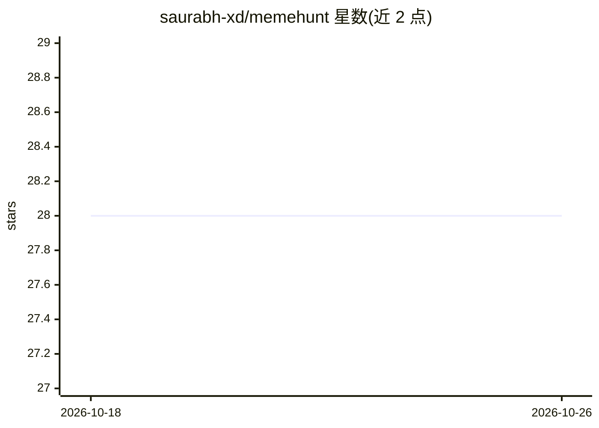

# saurabh-xd/memehunt

⭐ 28 · TypeScript · 推送 2026-09-22 · [GitHub](https://github.com/saurabh-xd/memehunt) · [官网](https://www.memehunt.tech) · 个人维护

**面向普通用户的 AI 表情包检索与编辑 Web 应用**

基于 Next.js 的全栈 Web 应用：用 RAG（Gemini 768 维嵌入 + Neon pgvector）对表情包模板做语义检索，取最相关的 12 个模板后再经 AI 排序，用户在 Canvas 编辑器中加自定义文字与图片贴层，支持默认/自定义水印并导出图片。后端用 Next.js API Routes、Prisma、Vercel AI SDK，认证采用 Better Auth + Google OAuth，含访客用量限制。需 Node.js 18+、带 pgvector 的 Postgres、Gemini/Groq API key，本地 git clone + npm 安装运行；尚未添加开源许可证。

## 筛选速览

| 维度 | 判定 | 备注 |
|---|---|---|
| AI 角色 | `ai-native` | 本体是模型或模型工具 |
| 许可风险 | `none` | — |
| 部署形态 | `library` | 以包/库形式分发 |
| 模型依赖 | — | README 未给出锁定关系 |
| 硬件要求 | — | 无带数字的原话,不猜 |
| 安装摩擦 | `low` | 无编译、无系统依赖或容器化 |
| 成熟度 | — | 结构信号不足 |

## 能力要点

- Gemini 嵌入 + Neon pgvector 的 RAG 模板语义检索
- 语义检索取 12 个候选后 AI 排序
- Konva Canvas 编辑器：自定义文字/图片贴层与水印
- 可断点续跑的嵌入回填脚本，支持批量导入

## 适用场景

- 用语义描述快速找到合适的表情包模板
- 在浏览器里给模板加文字和贴图后导出
- 管理员通过后台维护模板库并自动建立嵌入索引

## 场景标签

 · 领域:创意工具/Web 应用

## 证据(README 行号)

> L3: An AI meme finder and editor built with Next.js. MemeHunt uses retrieval-augmented generation (RAG) to find semantic
> L9: - RAG-powered meme matching with Gemini embeddings and Neon pgvector
> L10: - Semantic retrieval of the 12 most relevant templates before AI ranking

## 星数曲线

2026-10-18 28 → 2026-10-26 28（+0）

---
*卡片 v1 · prompt 1.4 · 生成 2026-10-26 · 置信度 high · 依据 README sha `54eac61038e5` · [字段定义](../../DATASET.md)*
